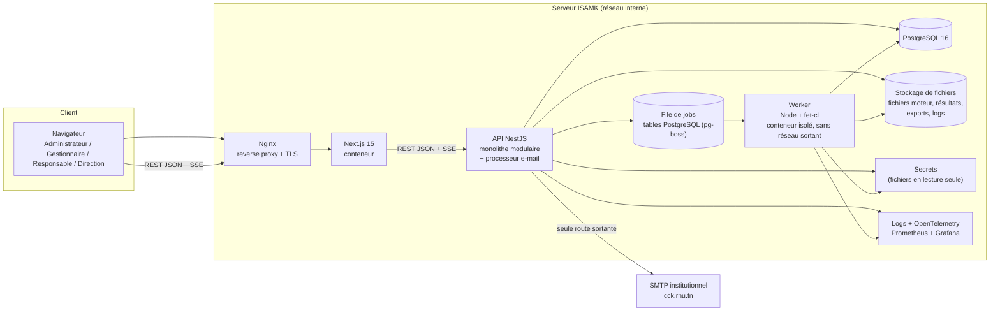
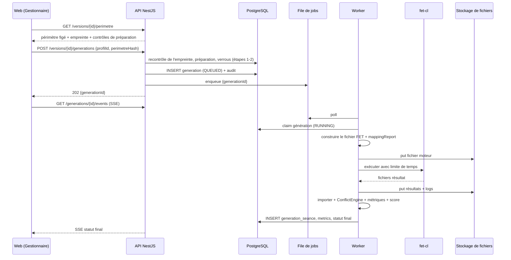
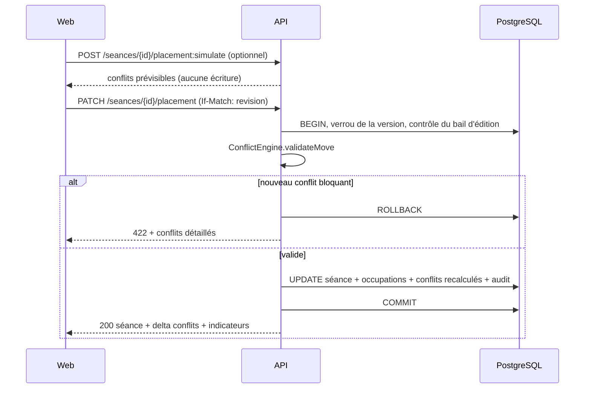
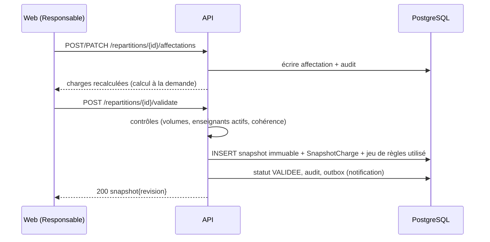
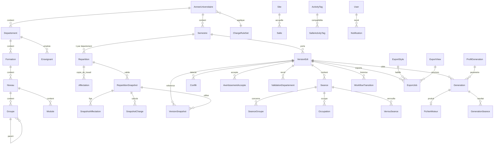
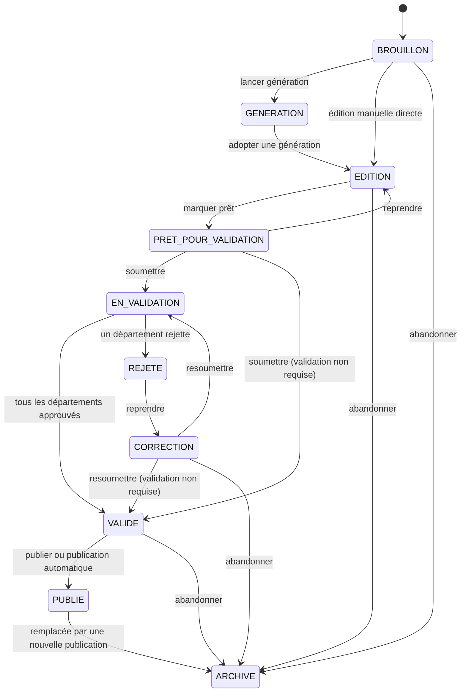

# Spécification technique — TAKT

**Application de gestion des emplois du temps de l'ISAM Kairouan (ISAMK)** · ST version 1.0 · 3 octobre 2026

> Document destiné à l'équipe de développement. Il traduit la spécification fonctionnelle (`SF_TAKT.md`) en décisions d'architecture, modèle de données, contrats d'API, algorithmes et règles de sécurité. Les exigences sont citées par leur code `EX-…`. Les décisions de référence sont dans le Decision Log de la SF (§26). Les hypothèses encore ouvertes sont listées en 0.4.

## Sommaire

0. Cadrage, décisions et hypothèses
1. Architecture et composants techniques
2. Modélisation de la base de données
3. Architecture des API (contrat d'interface)
4. Logique métier et algorithmes clés
5. Sécurité et performances
6. Plan de livraison, spikes et risques

---

## 0. Cadrage, décisions et hypothèses

### 0.1 Stack technique retenue

| Couche | Choix |
| --- | --- |
| Frontend | Next.js 15 (App Router), TypeScript strict, React Query, dnd-kit (grille d'édition), Tailwind + shadcn/ui, i18n (textes externalisés), interface en français uniquement, polices auto-hébergées |
| Backend | Node.js 24 LTS, NestJS 10+, monolithe modulaire, OpenAPI généré (`@nestjs/swagger`) |
| Base de données | PostgreSQL 16, Prisma 8 (`@prisma/orm-postgres`) – contrat PSL 8 (`prisma/contract.prisma`), artefacts générés (`contract.json`/`contract.d.ts`), client ORM dans `@takt/db` ; migrations gérées par `prisma migration plan` / `db migrate` (graphes, refs) ; migrations SQL brutes uniquement pour les invariants non supportés par Prisma |
| Moteur de planification | FET 7.12.0 (binaire `fet-cl`), isolé dans un worker conteneurisé, derrière un port `SchedulingEngine` |
| Asynchrone | File de jobs dans PostgreSQL (pg-boss) pour les générations, les exports et l'envoi d'e-mails ; SSE pour le suivi temps réel |
| Hébergement | Sur site, réseau interne de l'ISAMK (1.8) : Nginx (reverse proxy, TLS), Docker Compose, PostgreSQL 16, stockage de fichiers local derrière un port `FileStore`, secrets en fichiers, Prometheus et Grafana |
| Authentification | Locale : argon2id, JWT d'accès court + refresh rotatif, RBAC avec portée par département |
| Notifications | Boîte de réception applicative (SSE) et e-mail par SMTP institutionnel `cck.rnu.tn` |
| Exports | ExcelJS (XLSX), rendu HTML → PDF (Playwright/Chromium) |

La SF recommande « Java/Spring Boot ou .NET selon les compétences de l'équipe » et propose RabbitMQ « ou équivalent » : la décision est Node.js/NestJS avec pg-boss, avec React/TypeScript pour le frontend.

### 0.2 Décisions structurantes

| # | Décision | Conséquence technique |
| --- | --- | --- |
| B1 | Séance = créneau hebdomadaire récurrent par semestre | Pas de dates dans `Seance` : `jour` + `creneauDebut` + `nbCreneaux`. Alignement natif avec FET. |
| B2 | Une version = un semestre, toute l'institution | Un seul profil FET par génération. Une seule version `PUBLIE` par semestre. Validation par les Responsables de chaque département concerné. |
| B3 | Publication = statut interne ; consultation dans l'application par les rôles autorisés (dont la Direction) et diffusion par exports | Aucun portail public ni compte enseignant ou étudiant. Les notifications sont internes à l'ISAMK (EX-NOT-01 à 03). |
| B4 | Modifications de répartition prises en compte dans la prochaine version | Répartition par département validée sous forme de **snapshot immuable**. Chaque version référence ses snapshots. Pas de recalcul rétroactif. |
| B5 | Import depuis une année clôturée limité aux données de base | Copie sélective par type de donnée, avec aperçu, conservation du lien `originId` (4.9). |
| B6 | Charge entièrement paramétrable | Jeu de règles de charge versionné et immuable une fois publié (`ChargeRuleSet`). |
| B7 | Couverture totale obligatoire avant soumission | Contrôle de complétude bloquant. La sur-planification est un conflit pédagogique bloquant. |
| B8 | Périmètre de génération = semestre complet, affiché et figé | Une génération active par semestre ; évolutions notées dans la SF §25 (EX-GEN-02, EX-GEN-05). |

### 0.3 Règles de conception

| ID | Sujet | Règle |
| --- | --- | --- |
| RC-01 | Conflits bloquants | Bloquants et jamais acceptables : enseignant, salle, groupe, capacité maximale, disponibilité, compatibilité, règle pédagogique, complétude, verrou, salle non autorisée. Avertissements acceptables : 4.15. |
| RC-02 | Changement d'enseignant en édition | Autorisé uniquement vers un enseignant déjà affecté au même (module, type, groupe) dans le snapshot ; sinon une demande de modification est proposée au Responsable. |
| RC-03 | États de version | La version porte la machine d'états complète (4.1.1). La génération est un objet séparé. De `CORRECTION`, la resoumission va directement à `EN_VALIDATION` ou `VALIDE` selon le circuit figé. |
| RC-04 | Numérotation des versions | Majeur +1 pour un nouveau snapshot de répartition ou une nouvelle génération adoptée ; mineur +1 pour les corrections manuelles. |
| RC-05 | Concurrence | Bail d'édition exclusif par version (30 minutes, renouvelable) et contrôle optimiste (`If-Match` sur `revision`). |
| RC-06 | Politique d'édition | Un déplacement qui crée un nouveau conflit bloquant est refusé (422). Les conflits persistants proviennent de changements de référentiel ou d'import et bloquent la soumission. |
| RC-07 | Contraintes souples | Prises en compte par FET à la génération sans optimisation poussée (`fet-cl` s'arrête à la première solution complète : multi-graines, 4.6.6) ; l'application évalue un sous-ensemble (heures consécutives, creux, plages à éviter, équilibre, vœux, covoiturage) pour l'édition, la comparaison et le score. |
| RC-08 | Créneaux | Un créneau dure exactement 30 minutes (constante `SLOT_MINUTES`). Tout volume est un multiple de 30 minutes. Les créneaux sont rattachés au semestre, jamais reconduits automatiquement. |
| RC-09 | Périmètre fonctionnel | Hors v1.0 : co-enseignement (plusieurs enseignants par séance), modules partagés entre formations. Supporté : CM commun à plusieurs groupes. |
| RC-10 | Régénération partielle | Les verrous de créneau, de salle et d'activité sont envoyés à FET comme positions imposées (4.14). |
| RC-11 | Rôles | Quatre rôles (EX-ROL-01). Les gardes de transition portent sur les permissions, pas sur les noms de rôle. |
| RC-12 | Fuseau | Heures de créneaux stockées sans fuseau (heure locale d'établissement) ; horodatages en UTC, affichés en `Africa/Tunis`. |

### 0.4 Hypothèses à confirmer

| ID | Sujet | Hypothèse retenue | Impact si modifiée |
| --- | --- | --- | --- |
| HY-01 | Volumétrie | 2 départements, 120 enseignants, 30 salles, 500 séances par semestre, 10 comptes, 5 utilisateurs simultanés (valeurs fournies) | Dimensionnement (section 5) |
| HY-02 | Positions imposées dans FET | Validé : les verrous sont transmis comme contraintes d'heure et de salle avec poids 100 % (spike S1, ticket de régénération partielle) | 4.14, 4.6.2 |
| HY-03 | Conservation INPDP | Audit: 5 ans, journal de sécurité: 3 ans, exports: 1 an (durées configurables, valeurs par défaut à valider avec le DPO) | Politique de purge (EX-AUD-02) |
| HY-04 | Volumes prévus | Validé : l'ISAMK fournit la maquette pédagogique par (module, type) en entrée du processus de saisie guidée (EX-REF-01) | Saisie guidée (EX-REF-01) |
| HY-05 | Valeurs initiales de charge | Grades: Assistant, Maître assistant, Maître de conférences, Professeur, PES, PES_P, PES_A, Contrat expert, Vacataire, Contrat (charge de référence = 0). Coeff. activités (CM,TD,TP,CI…) = 1. Seuil = 1. Plafond = charge de référence + 4 | EX-CHG-01 |
| HY-06 | SMTP institutionnel | Paramètres de `cck.rnu.tn` (port 587, TLS STARTTLS, authentification requise, limites et adresse expéditeur à définir par l'ISAMK) à fournir par l'ISAMK | EX-NOT-02, règle réseau de l'API |
| HY-07 | Serveur sur site | Dimensionnement : 4 vCPU, 16 Go RAM, 200 Go SSD RAID 1 ; sauvegardes : continues (pgBackRest) avec rétention 35 jours complète, fichiers sauvegardés quotidiennement, copie sur support distinct, procédure documentée, tests de restauration trimestriels ; mises à jour : appliquées selon calendrier ISAMK ; surveillance : journaux structurés et métriques (Prometheus/Grafana) avec alertes sur seuils | 1.8, EX-NFR-03 |
| HY-08 | Capacité de salle dans FET | Validé : la règle `ROOM_CAPACITY` est activée et la capacité des salles est prise en compte dans la génération (test T6 à valider lors du déploiement) | 4.6.2 |
| HY-09 | SSO | Non prévu pour v1.0 ; évolution possible vers SSO institutionnel dans les versions futures | EX-SEC-01 |

### 0.5 Conventions

- Identifiants : UUID (`@db.Uuid`). Noms de tables en `snake_case` via `@@map` à l'implémentation.
- Durées stockées en **minutes** (entiers). Heures de créneaux en `TIME`, sans fuseau.
- Horodatages en UTC (`timestamptz`), convertis côté interface.
- Toute écriture métier passe par un use case NestJS transactionnel qui écrit l'audit dans la même transaction.
- Tous les endpoints sont préfixés `/api/v1`. Toutes les erreurs suivent la RFC 9457 (`application/problem+json`).
- Rôles dans les tableaux d'API : **A** Administrateur, **G** Gestionnaire, **R** Responsable de département (dans sa portée), **D** Direction. L'Administrateur détient les droits du Gestionnaire : une ligne notée « G » vaut aussi pour A.
- Libellés d'états : l'interface n'affiche que les libellés de la SF §20.

---

## 1. Architecture et composants techniques

### 1.1 Principes

- **Monolithe modulaire** (API NestJS) : volumétrie modeste, équipe réduite, transactions fortes (conflits, versions).
- **Un worker séparé** pour tout ce qui est long ou risqué : génération FET, exports PDF volumineux. L'envoi d'e-mails est traité par un processeur de l'API.
- **API-first** : contrat OpenAPI source de vérité, types partagés par un paquet `contracts`.
- **Ports et adaptateurs** : le domaine ne connaît pas FET. L'interface `SchedulingEngine` isole l'adaptateur `FetAdapter` (EX-MOT-01).
- **Source de vérité unique** : PostgreSQL. FET ne reçoit que des fichiers dérivés et jetables (EX-PRI-01).
- **Invariants dans la base** autant que possible : index uniques, contraintes CHECK, triggers d'immutabilité.

### 1.2 Schéma conceptuel



### 1.3 Composants

| Composant | Rôle | Notes |
| --- | --- | --- |
| **Web (Next.js)** | Interface, grille d'édition, tableaux de bord. | Server Components pour la lecture, Client Components pour la grille. Aucune logique d'autorisation côté Next : l'API fait foi. |
| **API (NestJS)** | Logique métier, RBAC, workflow, détection de conflits, calcul des charges, notifications. | Sans état, scalable horizontalement. Seule route sortante autorisée : SMTP. |
| **Worker** | Construit le fichier FET, exécute `fet-cl`, importe le résultat, génère les exports lourds. | Image dédiée. Aucun accès réseau sortant. Accès base limité. |
| **PostgreSQL** | Données métier, versions, audit, journal de sécurité. | Rôles distincts : `app_rw`, `worker_rw` (tables ciblées), `audit_ro`, `audit_purge`. |
| **Stockage de fichiers** | Fichiers moteur, sorties FET, journaux d'exécution, exports, logos. | Port `FileStore` : volume local sur disque chiffré, empreintes SHA-256, versions conservées. Téléchargements par URL signées courtes émises par l'API (jeton HMAC à durée limitée). |
| **File de jobs** | Tables PostgreSQL (pg-boss) avec file d'échecs après 3 tentatives. | Un job de génération actif au plus par semestre (garde applicative). Files : `generation`, `export`, `email`. |

### 1.4 Modules NestJS

| Module | Responsabilité | Dépendances principales |
| --- | --- | --- |
| `auth` | Connexion, refresh, MFA, réinitialisation, paramètres de sécurité, journal de sécurité | `users` |
| `users` | Utilisateurs, rôles, portées | — |
| `annees` | Années, semestres, transitions, import depuis une année clôturée | `referentiel`, `audit` |
| `referentiel` | Départements, formations, niveaux, groupes, modules, types, Activity Tags, volumes prévus, sites | `annees` |
| `enseignants` | Enseignants, modules enseignables, décharges | `referentiel` |
| `salles` | Salles, types, équipements, compatibilités par tag | `referentiel` |
| `creneaux` | Grille horaire par semestre, pauses, correspondance Ramadan | `annees` |
| `indisponibilites` | Indisponibilités enseignants et salles | `enseignants`, `salles`, `creneaux` |
| `repartition` | Affectations, validation, snapshots, demandes de modification | `referentiel`, `charge` |
| `charge` | Jeux de règles de charge, calcul des charges | `repartition` |
| `contraintes` | Catalogue, instances, vœux, covoiturage, exigences de salle, rapport de traduction | `referentiel` |
| `profils` | Profils de génération versionnés | `contraintes` |
| `planification` | Séances, versions, verrous, numérotation | `repartition`, `creneaux` |
| `conflits` | `ConflictEngine` (paquet partagé API/worker), avertissements acceptés | `planification` |
| `generations` | Cycle de vie, périmètre, comparaison, score, adoption | `contraintes`, `planification`, port moteur |
| `engine-fet` | Adaptateur FET (`FetAdapter`) | port `SchedulingEngine` |
| `editeur` | Déplacements, simulation, suggestions | `conflits` |
| `workflow` | Transitions, validations, impact, publication | `planification`, `conflits` |
| `archivage` | Clôture d'année, garde d'immutabilité | `annees`, `workflow` |
| `notifications` | Boîte de réception, événements, file e-mail | transverse |
| `tableau-de-bord` | Agrégation par rôle | transverse (lecture) |
| `exports` | Modèles visuels, configurations de vue, jobs d'export | `planification`, `charge` |
| `audit` | Journal d'audit append-only | transverse |

Communication inter-modules : appels de services via interfaces et événements de domaine (`EventEmitter2`, outbox transactionnelle pour les effets asynchrones : notifications, e-mails).

### 1.5 Organisation du dépôt

```text
takt/
├─ apps/
│  ├─ web/              # Next.js 15
│  ├─ api/              # NestJS
│  └─ worker/           # consommateur de la file de jobs (génération FET, exports)
├─ packages/
│  ├─ contracts/        # schémas Zod / types OpenAPI partagés
│  ├─ conflict-engine/  # logique pure, partagée API + worker
│  ├─ charge-engine/    # calcul de charge, logique pure
│  ├─ engine-fet/       # constructeur du fichier FET + parser du résultat
│  ├─ design-tokens/    # tokens de conception, variables CSS, configuration Tailwind
│  └─ db/               # schéma Prisma, migrations SQL, seed
├─ infra/               # Docker Compose, Nginx, scripts Ansible
└─ docs/
```

### 1.6 Port du moteur de planification

```ts
export interface SchedulingEngine {
  readonly id: string;                                // "fet"
  describeCapabilities(): EngineCapabilities;         // règles traduisibles (EX-MOT-03)
  buildProfile(input: EngineInput): Promise<EngineFile>;   // + mappingReport
  run(file: EngineFile, opts: EngineRunOptions, signal: AbortSignal): Promise<EngineRawResult>;
  importResult(raw: EngineRawResult, input: EngineInput): Promise<EngineSolution>;
}

export interface EngineFile {
  engineVersion: string;
  builderVersion: string;      // version du constructeur et du mapping
  payload: Buffer;             // XML .fet pour FET
  sha256: string;
  mappingReport: MappingReportItem[];  // TRADUITE | PARTIELLE | NON_TRADUITE
}
```

`EngineInput` est un modèle neutre (activités, ressources, créneaux, contraintes, verrous), jamais un type Prisma. Un futur moteur n'implémente que ce port.

### 1.7 Flux de données

#### Flux 1 : génération FET (EX-GEN-02 à EX-GEN-07)



#### Flux 2 : édition manuelle d'une séance



#### Flux 3 : répartition, snapshot et charges



#### Flux 4 : soumission, validation ciblée et publication

```mermaid
sequenceDiagram
  participant G as Gestionnaire
  participant RP as Responsable (par département)
  participant API as API
  participant DB as PostgreSQL
  G->>API: POST /versions/{id}/transitions {SOUMETTRE}
  API->>DB: contrôles bloquants + couverture ; figer le circuit
  API->>API: analyse d'impact (4.13) ; report des approbations non impactées
  API->>DB: ValidationDepartement par département, statut EN_VALIDATION (ou VALIDE / PUBLIE selon le circuit)
  RP->>API: POST /versions/{id}/validations {departementCode, APPROUVE | REJETE+motif}
  API->>DB: décision ; transition automatique (VALIDE ou REJETE)
  G->>API: POST /versions/{id}/publish
  API->>DB: recontrôle, PUBLIE, ancienne publiée → ARCHIVE, correspondance Ramadan figée, outbox
  API-->>G: 200 version immuable
```

#### Flux 5 : export

`POST /exports` → validation des droits et des paramètres → `ExportJob` (QUEUED) → file de jobs → le worker rend le modèle (PDF ou XLSX) avec le modèle visuel et la configuration de vue → stockage de fichiers → statut `DONE` → `GET /exports/{id}/download` renvoie une URL signée. Chaque export enregistre les versions du modèle visuel et de la configuration de vue pour pouvoir être régénéré (EX-EXP-04).

#### Flux 6 : notification

Un use case métier écrit, dans sa transaction, la ligne `Notification` (une par destinataire) avec `emailStatut = EN_ATTENTE` quand l'événement prévoit un e-mail. Après commit, un événement pousse l'état vers la boîte de réception (SSE). Un processeur de la file `email` envoie le message par SMTP avec reprises exponentielles ; l'échec final passe la notification en `ECHEC`, alimente la file d'échecs et déclenche l'alerte (4.16).

### 1.8 Hébergement sur site

Déploiement dans le réseau interne de l'ISAMK, les données restent en Tunisie (EX-NFR-01).

| Fonction | Cible |
| --- | --- |
| Point d'entrée, TLS, limitation de débit | Nginx en reverse proxy, pare-feu réseau |
| Exécution des conteneurs | Docker, orchestré par Docker Compose sur un serveur |
| Base de données | PostgreSQL 16 avec sauvegarde continue (pgBackRest) |
| Fichiers | Volume local dédié sur disque chiffré derrière le port `FileStore` ; MinIO possible plus tard sans changer le code |
| File de jobs et file d'échecs | Tables PostgreSQL (pg-boss), file d'échecs après 3 tentatives |
| Secrets | Fichiers montés en lecture seule, hors des images, avec procédure de rotation (dont les paramètres SMTP) |
| Observabilité | Journaux structurés avec rotation, Prometheus et Grafana |
| Infrastructure en code | Fichiers Compose, configuration Nginx et scripts Ansible dans `infra/` |
| CI/CD | Pipeline CI et registre d'images privé interne, déploiement par scripts |
| Environnements | Développement sur les postes, un serveur de recette, un serveur de production |

**Conséquences.** (1) Un seul serveur de production, sans haute disponibilité : risque inscrit en 6.3. (2) L'exploitation (mises à jour, sauvegardes, surveillance, certificats) revient à l'équipe de l'ISAMK. (3) `FileStore` et la file de jobs restent des interfaces. (4) Seule route sortante : l'API vers le SMTP institutionnel ; le worker n'en a aucune.

---

## 2. Modélisation de la base de données

### 2.1 Principes de modélisation

- **Référentiel par année** : départements, formations, niveaux, groupes, modules, enseignants, salles sont rattachés à une année. `originId` relie une entité à son équivalent de l'année source d'un import (4.9).
- **Répartition mutable + snapshots immuables** (B4) : `Affectation` est la copie de travail ; `RepartitionSnapshot`, `SnapshotAffectation`, `SnapshotCharge` sont figés à la validation.
- **Séances rattachées à une version** (B1, B2) : jour + créneau de début + nombre de créneaux. La table `Occupation`, dérivée, garantit l'unicité des ressources par créneau.
- **Résultats de génération séparés** des séances d'une version : on compare plusieurs générations sans rien perdre, puis on en adopte une.
- **Immutabilité** garantie par triggers (versions publiées ou archivées, années clôturées, snapshots, audit).
- Les champs « auteur » sans relation Prisma sont des FK logiques vers `User`.
- Prisma ne gère pas les index partiels, CHECK et triggers : voir 2.4 (migrations SQL brutes).
- Le schéma ci-dessous est la référence de conception. Sa validation par `prisma validate` a été exécutée avec succès (schéma validé) dans le cadre du spike S3; sa première migration a été créée dans le répertoire prisma/migrations/.

### 2.2 Schéma Prisma

```prisma
generator client {
  provider = "prisma-client-js"
}

datasource db {
  provider = "postgresql"
  url      = env("DATABASE_URL")
}

// ============================ ENUMS ============================

enum RoleCode { ADMINISTRATEUR GESTIONNAIRE RESPONSABLE_DEPARTEMENT DIRECTION }
enum AnneeStatut { PREPARATION ACTIVE CLOTUREE }
enum RepartitionStatut { BROUILLON VALIDEE ROUVERTE }
enum VersionStatut {
  BROUILLON GENERATION EDITION PRET_POUR_VALIDATION EN_VALIDATION
  REJETE CORRECTION VALIDE PUBLIE ARCHIVE
}
enum GenerationStatut { QUEUED RUNNING SUCCEEDED SUCCEEDED_WITH_WARNINGS FAILED CANCELLED TIMED_OUT }
enum GenerationMode { AUTOMATIQUE MANUELLE }
enum JourSemaine { LUNDI MARDI MERCREDI JEUDI VENDREDI SAMEDI }
enum GroupeType { SECTION GROUPE SOUS_GROUPE }
enum SeanceStatut { PLACEE NON_PLACEE }
enum SeanceOrigine { MOTEUR MANUEL }
enum RessourceType { ENSEIGNANT SALLE GROUPE }
enum ConflitType {
  ENSEIGNANT SALLE GROUPE CAPACITE DISPONIBILITE COMPATIBILITE PEDAGOGIQUE
  COMPLETUDE VERROU COVOITURAGE VOEU
}
enum ConflitSeverite { BLOQUANT AVERTISSEMENT INFORMATION }
enum ContrainteCategorie { DURE SOUPLE }
enum ContraintePortee { GLOBALE ENSEIGNANT GROUPE SALLE MODULE }
enum ContrainteNature { REGLE VOEU }
enum FetSupport { NATIF PARTIEL AUCUN }
enum ChargePeriode { HEBDOMADAIRE SEMESTRIELLE ANNUELLE }
enum ImpactDepartement { IMPACTE NON_IMPACTE }
enum DecisionDepartement { EN_ATTENTE APPROUVE REJETE }
enum DemandeType { ANOMALIE MODIFICATION }
enum DemandeStatut { OUVERTE TRAITEE REFUSEE }
enum ExigenceNiveau { OBLIGATOIRE SOUHAITE }
enum VerrouType { CRENEAU SALLE ENSEIGNANT ACTIVITE }
enum ExportFormat { PDF XLSX }
enum ExportMode { BROUILLON OFFICIEL }
enum GrilleAffichage { NORMALE RAMADAN }
enum JobStatut { QUEUED RUNNING DONE FAILED }
enum EmailStatut { NON_APPLICABLE EN_ATTENTE ENVOYE ECHEC }

// ============ UTILISATEURS, SÉCURITÉ & PARAMÈTRES ============

model User {
  id                 String    @id @default(uuid()) @db.Uuid
  email              String    @unique
  passwordHash       String
  nom                String
  prenom             String
  actif              Boolean   @default(true)
  desactiveLe        DateTime?
  failedAttempts     Int       @default(0)
  lockedUntil        DateTime?
  mfaSecret          String?
  mfaActive          Boolean   @default(false)
  mustChangePassword Boolean   @default(false)
  passwordChangedAt  DateTime  @default(now())
  lastLoginAt        DateTime?
  createdAt          DateTime  @default(now())
  updatedAt          DateTime  @updatedAt

  roles          UserRole[]
  refreshTokens  RefreshToken[]
  passwordHistory PasswordHistory[]
  resetTokens    PasswordResetToken[]
  versions       VersionEdt[]          @relation("VersionAuteur")
  transitions    WorkflowTransition[]
  validations    ValidationDepartement[]
  notifications  Notification[]
}

model UserRole {
  id              String   @id @default(uuid()) @db.Uuid
  userId          String   @db.Uuid
  role            RoleCode
  // Portée : code stable de département (null = global). Obligatoire pour RESPONSABLE_DEPARTEMENT.
  departementCode String?

  user User @relation(fields: [userId], references: [id], onDelete: Cascade)

  @@unique([userId, role, departementCode])
}

model RefreshToken {
  id             String    @id @default(uuid()) @db.Uuid
  userId         String    @db.Uuid
  familyId       String    @db.Uuid
  tokenHash      String    @unique
  expiresAt      DateTime
  revokedAt      DateTime?
  lastActivityAt DateTime  @default(now()) // inactivité (EX-SEC-07)
  userAgent      String?
  ip             String?
  createdAt      DateTime  @default(now())

  user User @relation(fields: [userId], references: [id], onDelete: Cascade)

  @@index([userId, familyId])
}

model PasswordHistory {
  id           String   @id @default(uuid()) @db.Uuid
  userId       String   @db.Uuid
  passwordHash String
  createdAt    DateTime @default(now())

  user User @relation(fields: [userId], references: [id], onDelete: Cascade)

  @@index([userId, createdAt])
}

model PasswordResetToken {
  id          String    @id @default(uuid()) @db.Uuid
  userId      String    @db.Uuid
  tokenHash   String    @unique
  expiresAt   DateTime
  usedAt      DateTime?
  demandePar  String    @db.Uuid // Administrateur qui a déclenché la réinitialisation
  createdAt   DateTime  @default(now())

  user User @relation(fields: [userId], references: [id], onDelete: Cascade)
}

// Paramètres de sécurité (ligne unique, CHECK id = 1) — EX-SEC-04
model ParametreSecurite {
  id                        Int        @id @default(1)
  longueurMin               Int        @default(12)      // plancher technique 8
  regles                    Json       @default("{}")    // {majuscule, minuscule, chiffre, symbole}
  expirationJours           Int        @default(0)       // 0 = pas d'expiration
  historique                Int        @default(5)
  maxEchecs                 Int        @default(5)
  verrouillageMinutes       Int        @default(15)
  inactiviteMinutes         Int        @default(30)
  mfaRoles                  RoleCode[] @default([ADMINISTRATEUR])
  conservationAuditJours    Int?       // null = sans purge
  conservationSecuriteJours Int        @default(365)
  updatedAt                 DateTime   @updatedAt
  updatedBy                 String?    @db.Uuid
}

// Circuit de validation et de publication (ligne unique, CHECK id = 1) — EX-WFL-02
model ParametreWorkflow {
  id                        Int      @id @default(1)
  validationPlanningRequise Boolean  @default(true)
  publicationRequise        Boolean  @default(true)
  updatedAt                 DateTime @updatedAt
  updatedBy                 String?  @db.Uuid
}

// Journal de sécurité, séparé de l'audit métier — EX-SEC-09
model SecurityEvent {
  id        BigInt   @id @default(autoincrement())
  at        DateTime @default(now())
  type      String   // LOGIN_OK, LOGIN_FAILED, ACCOUNT_LOCKED, TOKEN_REUSE, RESET_USED, MFA_ENROLLED, EXPORT_ACCESS...
  userId    String?  @db.Uuid
  email     String?
  ip        String?
  userAgent String?
  requestId String?
  details   Json?

  @@index([type, at])
  @@index([userId, at])
}

// ===================== ANNÉE & STRUCTURE =====================

model AnneeUniversitaire {
  id            String      @id @default(uuid()) @db.Uuid
  code          String      @unique // "2026-2027"
  libelle       String
  dateDebut     DateTime    @db.Date
  dateFin       DateTime    @db.Date
  statut        AnneeStatut @default(PREPARATION)
  chargeRuleSetId String?   @db.Uuid
  closedAt      DateTime?
  closedBy      String?     @db.Uuid
  createdAt     DateTime    @default(now())

  chargeRuleSet ChargeRuleSet? @relation(fields: [chargeRuleSetId], references: [id])
  semestres     Semestre[]
  departements  Departement[]
  enseignants   Enseignant[]
  salles        Salle[]
}

model Semestre {
  id             String   @id @default(uuid()) @db.Uuid
  anneeId        String   @db.Uuid
  numero         Int
  code           String   // "S1"
  libelle        String
  nbSemaines     Int      @default(14)
  grilleParams   Json?    // {jours:[{jour, debut, fin}], pauses:[...]} pour régénérer la grille
  profilDefautId String?  @db.Uuid

  annee            AnneeUniversitaire @relation(fields: [anneeId], references: [id])
  profilDefaut     ProfilGeneration?  @relation("ProfilDefaut", fields: [profilDefautId], references: [id])
  repartitions     Repartition[]
  versions         VersionEdt[]
  contraintes      ContrainteInstance[]
  generations      Generation[]
  decharges        DechargeEnseignant[]
  demandes         DemandeModification[]
  creneaux         Creneau[]
  indisponibilites Indisponibilite[]
  covoiturages     GroupeCovoiturage[]
  exigencesSalle   ExigenceSalleActivite[]

  @@unique([anneeId, numero])
}

model Departement {
  id       String  @id @default(uuid()) @db.Uuid
  anneeId  String  @db.Uuid
  code     String
  libelle  String
  originId String? @db.Uuid

  annee        AnneeUniversitaire @relation(fields: [anneeId], references: [id])
  formations   Formation[]
  enseignants  Enseignant[]
  salles       Salle[]
  repartitions Repartition[]

  @@unique([anneeId, code])
}

model Formation {
  id            String  @id @default(uuid()) @db.Uuid
  departementId String  @db.Uuid
  code          String
  libelle       String
  abreviation   String  // ex. "INFO" ; unique par année (index SQL) ; segment 2 du code de groupe
  originId      String? @db.Uuid

  departement Departement @relation(fields: [departementId], references: [id])
  niveaux     Niveau[]

  @@unique([departementId, code])
}

model Niveau {
  id          String  @id @default(uuid()) @db.Uuid
  formationId String  @db.Uuid
  code        String  // L1, L2, L3, M1, M2
  libelle     String
  ordre       Int     @default(0)
  originId    String? @db.Uuid

  formation Formation @relation(fields: [formationId], references: [id])
  groupes   Groupe[]
  modules   Module[]

  @@unique([formationId, code])
}

model Groupe {
  id             String     @id @default(uuid()) @db.Uuid
  niveauId       String     @db.Uuid
  parentId       String?    @db.Uuid
  code           String     // L2-INFO-1
  libelle        String
  type           GroupeType
  effectif       Int        @default(0)
  semestreNumero Int        // 1 ou 2 ; un enfant partage le semestre de son parent (trigger SQL)
  originId       String?    @db.Uuid

  niveau  Niveau   @relation(fields: [niveauId], references: [id])
  parent  Groupe?  @relation("GroupeHierarchie", fields: [parentId], references: [id])
  enfants Groupe[] @relation("GroupeHierarchie")

  affectations         Affectation[]
  snapshotAffectations SnapshotAffectation[]
  seanceGroupes        SeanceGroupe[]
  contraintes          ContrainteInstance[]

  @@unique([niveauId, semestreNumero, code])
  @@index([parentId])
}

model Module {
  id             String  @id @default(uuid()) @db.Uuid
  niveauId       String  @db.Uuid
  code           String
  libelle        String
  semestreNumero Int
  actif          Boolean @default(true)
  commentaire    String?
  originId       String? @db.Uuid

  niveau Niveau @relation(fields: [niveauId], references: [id])

  volumes              ModuleVolume[]
  exigences            ExigenceEquipement[]
  enseignants          EnseignantModule[]
  affectations         Affectation[]
  snapshotAffectations SnapshotAffectation[]
  seances              Seance[]
  contraintes          ContrainteInstance[]

  @@unique([niveauId, code])
}

model Grade {
  id      String @id @default(uuid()) @db.Uuid
  code    String @unique
  libelle String

  enseignants  Enseignant[]
  gradeCharges ChargeReferenceGrade[]
  coefficients ChargeCoefficient[]
}

// Référentiel distinct du type d'enseignement (EX-REF-05)
model ActivityTag {
  id      String  @id @default(uuid()) @db.Uuid
  code    String  @unique
  libelle String
  actif   Boolean @default(true)

  typesParDefaut       TypeEnseignement[]
  affectations         Affectation[]
  snapshotAffectations SnapshotAffectation[]
  sallesCompat         SalleActivityTag[]
  seances              Seance[]
}

model TypeEnseignement {
  id                  String  @id @default(uuid()) @db.Uuid
  code                String  @unique // CM, TD, TP, CI, AUTRE...
  libelle             String
  ordre               Int     @default(0)
  actif               Boolean @default(true)
  activityTagDefautId String  @db.Uuid

  activityTagDefaut    ActivityTag @relation(fields: [activityTagDefautId], references: [id])
  coefficients         ChargeCoefficient[]
  volumes              ModuleVolume[]
  exigences            ExigenceEquipement[]
  affectations         Affectation[]
  snapshotAffectations SnapshotAffectation[]
  seances              Seance[]
}

// Volume prévu par (module, type) — maquette pédagogique (EX-REF-01)
model ModuleVolume {
  id                 String @id @default(uuid()) @db.Uuid
  moduleId           String @db.Uuid
  typeEnseignementId String @db.Uuid
  volumeHebdoMinutes Int

  module Module           @relation(fields: [moduleId], references: [id], onDelete: Cascade)
  type   TypeEnseignement @relation(fields: [typeEnseignementId], references: [id])

  @@unique([moduleId, typeEnseignementId])
}

// ===================== RESSOURCES =====================

model Enseignant {
  id            String   @id @default(uuid()) @db.Uuid
  anneeId       String   @db.Uuid
  departementId String   @db.Uuid
  gradeId       String   @db.Uuid
  matricule     String
  nom           String
  prenom        String
  email         String?
  telephone     String?
  specialites   String[]
  actif         Boolean  @default(true)
  commentaire   String?
  originId      String?  @db.Uuid

  annee       AnneeUniversitaire @relation(fields: [anneeId], references: [id])
  departement Departement        @relation(fields: [departementId], references: [id])
  grade       Grade              @relation(fields: [gradeId], references: [id])

  modules              EnseignantModule[]
  decharges            DechargeEnseignant[]
  affectations         Affectation[]
  snapshotAffectations SnapshotAffectation[]
  snapshotCharges      SnapshotCharge[]
  seances              Seance[]
  indisponibilites     Indisponibilite[]
  contraintes          ContrainteInstance[]
  covoiturages         GroupeCovoiturageMembre[]

  @@unique([anneeId, matricule])
  @@index([departementId])
}

model EnseignantModule {
  enseignantId String @db.Uuid
  moduleId     String @db.Uuid

  enseignant Enseignant @relation(fields: [enseignantId], references: [id], onDelete: Cascade)
  module     Module     @relation(fields: [moduleId], references: [id], onDelete: Cascade)

  @@id([enseignantId, moduleId])
}

model DechargeEnseignant {
  id                 String  @id @default(uuid()) @db.Uuid
  enseignantId       String  @db.Uuid
  semestreId         String  @db.Uuid
  libelle            String
  heuresEquivalentes Decimal @db.Decimal(6, 2)
  motif              String?

  enseignant Enseignant @relation(fields: [enseignantId], references: [id], onDelete: Cascade)
  semestre   Semestre   @relation(fields: [semestreId], references: [id])

  @@index([enseignantId, semestreId])
}

model Site {
  id        String  @id @default(uuid()) @db.Uuid
  code      String  @unique
  libelle   String
  annexe    Boolean @default(false)
  principal Boolean @default(false)

  salles Salle[]
}

model TypeSalle {
  id      String @id @default(uuid()) @db.Uuid
  code    String @unique
  libelle String

  salles Salle[]
}

model Equipement {
  id      String @id @default(uuid()) @db.Uuid
  code    String @unique
  libelle String

  salles    SalleEquipement[]
  exigences ExigenceEquipement[]
}

model Salle {
  id                  String  @id @default(uuid()) @db.Uuid
  anneeId             String  @db.Uuid
  departementId       String? @db.Uuid // rattachement (null = partagée)
  typeSalleId         String  @db.Uuid
  siteId              String  @db.Uuid
  code                String
  libelle             String
  batiment            String?
  etage               String?
  capacite            Int     // capacité maximale (bloquante)
  capaciteRecommandee Int?    // avertissement acceptable
  accessiblePmr       Boolean @default(false)
  commentaire         String?
  actif               Boolean @default(true)
  originId            String? @db.Uuid

  annee       AnneeUniversitaire @relation(fields: [anneeId], references: [id])
  departement Departement?       @relation(fields: [departementId], references: [id])
  typeSalle   TypeSalle          @relation(fields: [typeSalleId], references: [id])
  site        Site               @relation(fields: [siteId], references: [id])

  equipements      SalleEquipement[]
  tagsCompat       SalleActivityTag[]
  seances          Seance[]
  indisponibilites Indisponibilite[]
  contraintes      ContrainteInstance[]
  exigencesImposee ExigenceSalleActivite[]
  exigencesListe   ExigenceSalleAutorisee[]

  @@unique([anneeId, code])
}

model SalleEquipement {
  salleId      String @db.Uuid
  equipementId String @db.Uuid

  salle      Salle      @relation(fields: [salleId], references: [id], onDelete: Cascade)
  equipement Equipement @relation(fields: [equipementId], references: [id])

  @@id([salleId, equipementId])
}

// Compatibilité salle ↔ Activity Tag (remplace la compatibilité par type d'enseignement)
model SalleActivityTag {
  salleId       String @db.Uuid
  activityTagId String @db.Uuid

  salle Salle       @relation(fields: [salleId], references: [id], onDelete: Cascade)
  tag   ActivityTag @relation(fields: [activityTagId], references: [id])

  @@id([salleId, activityTagId])
}

// Équipement requis par (module, type), obligatoire ou souhaité
model ExigenceEquipement {
  moduleId           String         @db.Uuid
  typeEnseignementId String         @db.Uuid
  equipementId       String         @db.Uuid
  niveau             ExigenceNiveau @default(OBLIGATOIRE)

  module     Module           @relation(fields: [moduleId], references: [id], onDelete: Cascade)
  type       TypeEnseignement @relation(fields: [typeEnseignementId], references: [id])
  equipement Equipement       @relation(fields: [equipementId], references: [id])

  @@id([moduleId, typeEnseignementId, equipementId])
}

model Creneau {
  id         String      @id @default(uuid()) @db.Uuid
  semestreId String      @db.Uuid
  jour       JourSemaine
  ordre      Int         // 1..n par jour, consécutifs
  heureDebut DateTime    @db.Time(0)
  heureFin   DateTime    @db.Time(0) // = heureDebut + 30 min (CHECK SQL)
  estPause   Boolean     @default(false)

  semestre         Semestre          @relation(fields: [semestreId], references: [id])
  seancesDebut     Seance[]
  indisponibilites Indisponibilite[]
  affichages       CreneauAffichage[]

  @@unique([semestreId, jour, ordre])
}

// Correspondance d'affichage de la grille Ramadan (EX-CAL-04). La grille NORMALE est dérivée de Creneau.
model CreneauAffichage {
  id         String          @id @default(uuid()) @db.Uuid
  creneauId  String          @db.Uuid
  grille     GrilleAffichage @default(RAMADAN)
  heureDebut DateTime        @db.Time(0)
  heureFin   DateTime        @db.Time(0) // durée libre, pas de contrainte de 30 minutes

  creneau Creneau @relation(fields: [creneauId], references: [id], onDelete: Cascade)

  @@unique([creneauId, grille])
}

// Indisponibilité absolue (enseignant XOR salle, CHECK en SQL)
model Indisponibilite {
  id           String      @id @default(uuid()) @db.Uuid
  semestreId   String      @db.Uuid
  enseignantId String?     @db.Uuid
  salleId      String?     @db.Uuid
  jour         JourSemaine
  creneauId    String      @db.Uuid
  motif        String?

  semestre   Semestre    @relation(fields: [semestreId], references: [id])
  enseignant Enseignant? @relation(fields: [enseignantId], references: [id], onDelete: Cascade)
  salle      Salle?      @relation(fields: [salleId], references: [id], onDelete: Cascade)
  creneau    Creneau     @relation(fields: [creneauId], references: [id])

  @@index([enseignantId, jour, creneauId])
  @@index([salleId, jour, creneauId])
}

// ===================== RÉPARTITION =====================

model Repartition {
  id                    String            @id @default(uuid()) @db.Uuid
  semestreId            String            @db.Uuid
  departementId         String            @db.Uuid
  statut                RepartitionStatut @default(BROUILLON)
  workingRevision       Int               @default(0) // +1 à chaque modification de la copie de travail
  lastValidatedRevision Int?
  validatedAt           DateTime?
  validatedBy           String?           @db.Uuid
  createdAt             DateTime          @default(now())
  updatedAt             DateTime          @updatedAt

  semestre     Semestre    @relation(fields: [semestreId], references: [id])
  departement  Departement @relation(fields: [departementId], references: [id])
  affectations Affectation[]
  snapshots    RepartitionSnapshot[]

  @@unique([semestreId, departementId])
}

model Affectation {
  id                 String   @id @default(uuid()) @db.Uuid
  repartitionId      String   @db.Uuid
  groupeId           String   @db.Uuid
  moduleId           String   @db.Uuid
  typeEnseignementId String   @db.Uuid
  activityTagId      String?  @db.Uuid // null = tag par défaut du type
  enseignantId       String   @db.Uuid
  volumeHebdoMinutes Int
  nbSeances          Int      @default(1)
  dureeCreneaux      Int      @default(1)
  // Affectations partageant la même clé → une seule séance (CM commun)
  groupeCommunKey    String?
  commentaire        String?
  createdAt          DateTime @default(now())
  updatedAt          DateTime @updatedAt

  repartition Repartition      @relation(fields: [repartitionId], references: [id], onDelete: Cascade)
  groupe      Groupe           @relation(fields: [groupeId], references: [id])
  module      Module           @relation(fields: [moduleId], references: [id])
  type        TypeEnseignement @relation(fields: [typeEnseignementId], references: [id])
  activityTag ActivityTag?     @relation(fields: [activityTagId], references: [id])
  enseignant  Enseignant       @relation(fields: [enseignantId], references: [id])

  @@unique([repartitionId, groupeId, moduleId, typeEnseignementId, enseignantId])
  @@index([enseignantId])
}

model RepartitionSnapshot {
  id               String   @id @default(uuid()) @db.Uuid
  repartitionId    String   @db.Uuid
  revision         Int
  chargeRuleSetId  String   @db.Uuid
  contentHash      String
  validatedBy      String   @db.Uuid
  parAdministrateur Boolean  @default(false) // validé par l'Administrateur pour ce département (EX-ROL-06)
  validatedAt      DateTime @default(now())

  repartition   Repartition   @relation(fields: [repartitionId], references: [id])
  chargeRuleSet ChargeRuleSet @relation(fields: [chargeRuleSetId], references: [id])
  affectations  SnapshotAffectation[]
  charges       SnapshotCharge[]
  versions      VersionSnapshot[]

  @@unique([repartitionId, revision])
}

model SnapshotAffectation {
  id                 String  @id @default(uuid()) @db.Uuid
  snapshotId         String  @db.Uuid
  groupeId           String  @db.Uuid
  moduleId           String  @db.Uuid
  typeEnseignementId String  @db.Uuid
  activityTagId      String  @db.Uuid // tag résolu (défaut du type si non fixé)
  enseignantId       String  @db.Uuid
  volumeHebdoMinutes Int
  nbSeances          Int
  dureeCreneaux      Int
  groupeCommunKey    String?

  snapshot    RepartitionSnapshot @relation(fields: [snapshotId], references: [id], onDelete: Cascade)
  groupe      Groupe              @relation(fields: [groupeId], references: [id])
  module      Module              @relation(fields: [moduleId], references: [id])
  type        TypeEnseignement    @relation(fields: [typeEnseignementId], references: [id])
  activityTag ActivityTag         @relation(fields: [activityTagId], references: [id])
  enseignant  Enseignant          @relation(fields: [enseignantId], references: [id])

  @@index([snapshotId])
  @@index([enseignantId])
}

// Charge d'un enseignant figée à la validation (EX-CHG-05)
model SnapshotCharge {
  id              String  @id @default(uuid()) @db.Uuid
  snapshotId      String  @db.Uuid
  enseignantId    String  @db.Uuid
  volumeBrut      Decimal @db.Decimal(8, 2) // heures réelles
  chargeCalculee  Decimal @db.Decimal(8, 2) // Σ volume brut × coefficient
  chargeReference Decimal @db.Decimal(8, 2) // charge du grade
  decharges       Decimal @db.Decimal(8, 2)
  serviceDu       Decimal @db.Decimal(8, 2) // max(0, référence − décharges)
  ecart           Decimal @db.Decimal(8, 2) // calculée − service dû (positif = dépassement)
  heuresSup       Decimal @db.Decimal(8, 2)
  detail          Json    // [{type, volume, coefficient, contribution, groupeCommunKey}]

  snapshot   RepartitionSnapshot @relation(fields: [snapshotId], references: [id], onDelete: Cascade)
  enseignant Enseignant          @relation(fields: [enseignantId], references: [id])

  @@unique([snapshotId, enseignantId])
}

// ===================== CHARGE PARAMÉTRABLE =====================

model ChargeRuleSet {
  id               String        @id @default(uuid()) @db.Uuid
  numero           Int           @unique
  libelle          String
  periode          ChargePeriode @default(SEMESTRIELLE)
  seuilHeuresSup   Decimal?      @db.Decimal(6, 2)
  plafondHeuresSup Decimal?      @db.Decimal(6, 2)
  arrondiDecimales Int           @default(2)
  config           Json?
  publieLe         DateTime?     // non null = immuable
  creePar          String        @db.Uuid
  creeLe           DateTime      @default(now())

  gradeCharges ChargeReferenceGrade[]
  coefficients ChargeCoefficient[]
  annees       AnneeUniversitaire[]
  snapshots    RepartitionSnapshot[]
}

model ChargeReferenceGrade {
  id              String  @id @default(uuid()) @db.Uuid
  ruleSetId       String  @db.Uuid
  gradeId         String  @db.Uuid
  chargeReference Decimal @db.Decimal(8, 2)

  ruleSet ChargeRuleSet @relation(fields: [ruleSetId], references: [id], onDelete: Cascade)
  grade   Grade         @relation(fields: [gradeId], references: [id])

  @@unique([ruleSetId, gradeId])
}

model ChargeCoefficient {
  id                 String  @id @default(uuid()) @db.Uuid
  ruleSetId          String  @db.Uuid
  typeEnseignementId String  @db.Uuid
  gradeId            String? @db.Uuid // coefficient propre à un grade, prioritaire sur le général
  coefficient        Decimal @db.Decimal(5, 3)

  ruleSet ChargeRuleSet    @relation(fields: [ruleSetId], references: [id], onDelete: Cascade)
  type    TypeEnseignement @relation(fields: [typeEnseignementId], references: [id])
  grade   Grade?           @relation(fields: [gradeId], references: [id])
}

// ===================== CONTRAINTES =====================

model ContrainteDefinition {
  id           String              @id @default(uuid()) @db.Uuid
  code         String              @unique
  libelle      String
  categorie    ContrainteCategorie
  portee       ContraintePortee
  paramsSchema Json
  fetSupport   FetSupport          @default(NATIF)
  actif        Boolean             @default(true)

  instances ContrainteInstance[]
}

model ContrainteInstance {
  id           String           @id @default(uuid()) @db.Uuid
  semestreId   String           @db.Uuid
  definitionId String           @db.Uuid
  enseignantId String?          @db.Uuid
  groupeId     String?          @db.Uuid
  salleId      String?          @db.Uuid
  moduleId     String?          @db.Uuid
  params       Json
  poids        Int?             // 0-100, null pour les dures ; un vœu : 25, 50, 75 ou 90, jamais 100
  nature       ContrainteNature @default(REGLE)
  commentaire  String?
  actif        Boolean          @default(true)
  creePar      String           @db.Uuid
  creeLe       DateTime         @default(now())

  semestre   Semestre             @relation(fields: [semestreId], references: [id])
  definition ContrainteDefinition @relation(fields: [definitionId], references: [id])
  enseignant Enseignant?          @relation(fields: [enseignantId], references: [id])
  groupe     Groupe?              @relation(fields: [groupeId], references: [id])
  salle      Salle?               @relation(fields: [salleId], references: [id])
  module     Module?              @relation(fields: [moduleId], references: [id])

  @@index([semestreId, actif])
}

// Covoiturage (EX-CTR-05) : APPLICATION_ONLY, évalué après import
model GroupeCovoiturage {
  id              String  @id @default(uuid()) @db.Uuid
  semestreId      String  @db.Uuid
  libelle         String
  margeMinutes    Int     @default(60)
  joursCommunsMin Int     @default(1)
  strict          Boolean @default(false)
  actif           Boolean @default(true)

  semestre Semestre                  @relation(fields: [semestreId], references: [id])
  membres  GroupeCovoiturageMembre[]
}

model GroupeCovoiturageMembre {
  groupeId     String @db.Uuid
  enseignantId String @db.Uuid

  groupe     GroupeCovoiturage @relation(fields: [groupeId], references: [id], onDelete: Cascade)
  enseignant Enseignant        @relation(fields: [enseignantId], references: [id])

  @@id([groupeId, enseignantId])
}

// Exigence de salle par activité (EX-ACT-04) : relève de la planification, hors snapshot de répartition.
// affectationKey = `${groupeId}:${moduleId}:${typeEnseignementId}:${enseignantId}`
model ExigenceSalleActivite {
  id             String   @id @default(uuid()) @db.Uuid
  semestreId     String   @db.Uuid
  affectationKey String
  salleImposeeId String?  @db.Uuid
  creePar        String   @db.Uuid
  creeLe         DateTime @default(now())

  semestre     Semestre                 @relation(fields: [semestreId], references: [id])
  salleImposee Salle?                   @relation(fields: [salleImposeeId], references: [id])
  autorisees   ExigenceSalleAutorisee[]

  @@unique([semestreId, affectationKey])
}

model ExigenceSalleAutorisee {
  exigenceId String @db.Uuid
  salleId    String @db.Uuid

  exigence ExigenceSalleActivite @relation(fields: [exigenceId], references: [id], onDelete: Cascade)
  salle    Salle                 @relation(fields: [salleId], references: [id])

  @@id([exigenceId, salleId])
}

// Profil de génération versionné (EX-GEN-01) : immuable dès qu'une génération l'a utilisé.
model ProfilGeneration {
  id                  String    @id @default(uuid()) @db.Uuid
  code                String
  numero              Int       // version du profil
  libelle             String
  dureeLimiteSecondes Int       @default(900)
  preserverVerrouilles Boolean  @default(true)
  engineVersion       String    // "7.11.1"
  builderVersion      String
  graines             Json?     // 6 entiers MRG32k3a {s10,s11,s12,s20,s21,s22}, tous requis ensemble (voir 4.6.6) ; null = tirage par le worker
  poids               Json      // poids des critères du score : {voeux, creuxGroupes, creuxEnseignants, heuresConsecutives, equilibre, utilisationSalles, capaciteRecommandee, covoiturage}
  utiliseLe           DateTime? // non null = immuable
  creePar             String    @db.Uuid
  creeLe              DateTime  @default(now())

  semestresDefaut Semestre[]   @relation("ProfilDefaut")
  generations     Generation[]

  @@unique([code, numero])
}

// ===================== VERSIONS & SÉANCES =====================

model VersionEdt {
  id                      String        @id @default(uuid()) @db.Uuid
  semestreId              String        @db.Uuid
  majeur                  Int
  mineur                  Int           @default(0)
  statut                  VersionStatut @default(BROUILLON)
  auteurId                String        @db.Uuid
  parentId                String?       @db.Uuid
  generationSourceId      String?       @db.Uuid
  motif                   String?
  revision                Int           @default(0) // contrôle optimiste
  editLockUserId          String?       @db.Uuid
  editLockExpiresAt       DateTime?
  cycleValidation         Int           @default(0)
  cycleValidationRequise  Boolean       @default(true) // circuit figé à SOUMETTRE / RESOUMETTRE
  cyclePublicationRequise Boolean       @default(true)
  soumisPar               String?       @db.Uuid // séparation des tâches (EX-ROL-06)
  ramadanFigee            Json?         // correspondance Ramadan figée à la publication (EX-CAL-04)
  publieLe                DateTime?
  publiePar               String?       @db.Uuid
  createdAt               DateTime      @default(now())
  updatedAt               DateTime      @updatedAt

  semestre         Semestre     @relation(fields: [semestreId], references: [id])
  auteur           User         @relation("VersionAuteur", fields: [auteurId], references: [id])
  parent           VersionEdt?  @relation("VersionParent", fields: [parentId], references: [id])
  enfants          VersionEdt[] @relation("VersionParent")
  generationSource Generation?  @relation("GenerationAdoptee", fields: [generationSourceId], references: [id])

  generations   Generation[]            @relation("GenerationCible")
  snapshots     VersionSnapshot[]
  seances       Seance[]
  occupations   Occupation[]
  conflits      Conflit[]
  verrous       VerrouSeance[]
  avertissements AvertissementAccepte[]
  transitions   WorkflowTransition[]
  validations   ValidationDepartement[]
  exports       ExportJob[]

  @@unique([semestreId, majeur, mineur])
  @@index([semestreId, statut])
}

model VersionSnapshot {
  versionId  String @db.Uuid
  snapshotId String @db.Uuid

  version  VersionEdt          @relation(fields: [versionId], references: [id], onDelete: Cascade)
  snapshot RepartitionSnapshot @relation(fields: [snapshotId], references: [id])

  @@id([versionId, snapshotId])
}

model Seance {
  id                 String        @id @default(uuid()) @db.Uuid
  versionId          String        @db.Uuid
  affectationKey     String        // `${groupeId}:${moduleId}:${typeEnseignementId}:${enseignantId}`
  rang               Int           @default(1) // index de la séance dans l'affectation
  moduleId           String        @db.Uuid
  typeEnseignementId String        @db.Uuid
  activityTagId      String        @db.Uuid
  enseignantId       String        @db.Uuid
  salleId            String?       @db.Uuid
  jour               JourSemaine?
  creneauDebutId     String?       @db.Uuid
  nbCreneaux         Int
  statut             SeanceStatut  @default(NON_PLACEE)
  origine            SeanceOrigine @default(MOTEUR)
  revision           Int           @default(0)
  createdAt          DateTime      @default(now())
  updatedAt          DateTime      @updatedAt

  version      VersionEdt       @relation(fields: [versionId], references: [id], onDelete: Cascade)
  module       Module           @relation(fields: [moduleId], references: [id])
  type         TypeEnseignement @relation(fields: [typeEnseignementId], references: [id])
  activityTag  ActivityTag      @relation(fields: [activityTagId], references: [id])
  enseignant   Enseignant       @relation(fields: [enseignantId], references: [id])
  salle        Salle?           @relation(fields: [salleId], references: [id])
  creneauDebut Creneau?         @relation(fields: [creneauDebutId], references: [id])

  groupes     SeanceGroupe[]
  occupations Occupation[]
  verrous     VerrouSeance[]

  @@unique([versionId, affectationKey, rang])
  @@index([versionId, jour, creneauDebutId])
  @@index([versionId, enseignantId])
  @@index([versionId, salleId])
}

model SeanceGroupe {
  seanceId String @db.Uuid
  groupeId String @db.Uuid

  seance Seance @relation(fields: [seanceId], references: [id], onDelete: Cascade)
  groupe Groupe @relation(fields: [groupeId], references: [id])

  @@id([seanceId, groupeId])
  @@index([groupeId])
}

// Occupation dérivée (une ligne par créneau couvert et par ressource).
model Occupation {
  id            String        @id @default(uuid()) @db.Uuid
  versionId     String        @db.Uuid
  seanceId      String        @db.Uuid
  jour          JourSemaine
  creneauId     String        @db.Uuid
  ressourceType RessourceType
  ressourceId   String        @db.Uuid

  version VersionEdt @relation(fields: [versionId], references: [id], onDelete: Cascade)
  seance  Seance     @relation(fields: [seanceId], references: [id], onDelete: Cascade)

  @@unique([versionId, jour, creneauId, ressourceType, ressourceId])
  @@index([seanceId])
}

model Conflit {
  id        String          @id @default(uuid()) @db.Uuid
  versionId String          @db.Uuid
  type      ConflitType
  severite  ConflitSeverite @default(BLOQUANT)
  regleCode String
  signature String          // empreinte stable (règle + séances + objet) : lie un avertissement accepté
  objetType String
  objetId   String
  seanceIds String[]        @db.Uuid
  message   String
  details   Json?
  detecteLe DateTime        @default(now())
  resoluLe  DateTime?

  version VersionEdt @relation(fields: [versionId], references: [id], onDelete: Cascade)

  @@index([versionId, resoluLe])
  @@index([versionId, type])
  @@index([versionId, signature])
}

// Verrous par séance (EX-VRR-01). Un verrou levé reste en base (historique).
model VerrouSeance {
  id            String     @id @default(uuid()) @db.Uuid
  versionId     String     @db.Uuid
  seanceId      String     @db.Uuid
  type          VerrouType
  auteurId      String     @db.Uuid
  justification String?
  creeLe        DateTime   @default(now())
  leveLe        DateTime?
  levePar       String?    @db.Uuid

  version VersionEdt @relation(fields: [versionId], references: [id], onDelete: Cascade)
  seance  Seance     @relation(fields: [seanceId], references: [id], onDelete: Cascade)

  @@index([versionId, leveLe])
  @@index([seanceId])
}

// Acceptation d'un avertissement (EX-CTR-07), liée à la signature du conflit.
model AvertissementAccepte {
  id              String    @id @default(uuid()) @db.Uuid
  versionId       String    @db.Uuid
  regleCode       String
  signature       String
  seanceIds       String[]  @db.Uuid
  auteurId        String    @db.Uuid
  justification   String?
  versionRevision Int
  acceptePar      String    @db.Uuid
  accepteLe       DateTime  @default(now())
  caduqueLe       DateTime? // renseigné quand la signature disparaît ou change

  version VersionEdt @relation(fields: [versionId], references: [id], onDelete: Cascade)

  @@index([versionId, signature])
}

// Décision par département pour un cycle de validation (EX-WFL-03, EX-WFL-04)
model ValidationDepartement {
  id                String              @id @default(uuid()) @db.Uuid
  versionId         String              @db.Uuid
  cycle             Int
  departementCode   String
  impact            ImpactDepartement
  decision          DecisionDepartement @default(EN_ATTENTE)
  reportee          Boolean             @default(false) // approbation reportée d'un cycle précédent
  cycleSource       Int?
  userId            String?             @db.Uuid
  parAdministrateur Boolean             @default(false)
  motif             String?
  raisonImpact      Json?               // séances modifiées, enseignant partagé, snapshot modifié
  at                DateTime?

  version VersionEdt @relation(fields: [versionId], references: [id], onDelete: Cascade)
  user    User?      @relation(fields: [userId], references: [id])

  @@unique([versionId, cycle, departementCode])
}

// ===================== GÉNÉRATION =====================

model Generation {
  id               String           @id @default(uuid()) @db.Uuid
  semestreId       String           @db.Uuid
  versionId        String           @db.Uuid
  auteurId         String           @db.Uuid
  statut           GenerationStatut @default(QUEUED)
  mode             GenerationMode   @default(AUTOMATIQUE)
  profilId         String?          @db.Uuid
  engine           String           @default("fet")
  engineVersion    String?
  params           Json             // copie des valeurs du profil au lancement
  perimetre        Json             // périmètre figé (EX-GEN-02)
  perimetreHash    String
  seeds            Json?            // 6 graines MRG32k3a effectivement utilisées {s10,s11,s12,s20,s21,s22}
  snapshotIds      String[]         @db.Uuid
  fichierAttendu   String?          // mode MANUELLE : empreinte du fichier moteur exporté
  metrics          Json?
  score            Decimal?         @db.Decimal(5, 2) // 0 à 100
  resultKey        String?
  logKey           String?
  erreur           String?
  cancelRequested  Boolean          @default(false)
  queuedAt         DateTime         @default(now())
  startedAt        DateTime?
  finishedAt       DateTime?

  semestre         Semestre          @relation(fields: [semestreId], references: [id])
  version          VersionEdt        @relation("GenerationCible", fields: [versionId], references: [id])
  profil           ProfilGeneration? @relation(fields: [profilId], references: [id])
  versionsAdoptees VersionEdt[]      @relation("GenerationAdoptee")
  fichierMoteur    FichierMoteur?
  seances          GenerationSeance[]

  @@index([semestreId, statut])
}

model FichierMoteur {
  id             String   @id @default(uuid()) @db.Uuid
  generationId   String   @unique @db.Uuid
  engine         String
  engineVersion  String
  builderVersion String
  storageKey     String
  sha256         String
  mappingReport  Json
  createdAt      DateTime @default(now())

  generation Generation @relation(fields: [generationId], references: [id], onDelete: Cascade)
}

// Résultat brut de génération (références scalaires, validées à l'import)
model GenerationSeance {
  id                 String       @id @default(uuid()) @db.Uuid
  generationId       String       @db.Uuid
  affectationKey     String
  rang               Int
  groupeIds          String[]     @db.Uuid
  moduleId           String       @db.Uuid
  typeEnseignementId String       @db.Uuid
  activityTagId      String       @db.Uuid
  enseignantId       String       @db.Uuid
  salleId            String?      @db.Uuid
  jour               JourSemaine?
  creneauDebutId     String?      @db.Uuid
  nbCreneaux         Int
  statut             SeanceStatut

  generation Generation @relation(fields: [generationId], references: [id], onDelete: Cascade)

  @@unique([generationId, affectationKey, rang])
}

// ===================== WORKFLOW, DEMANDES, NOTIFICATIONS, AUDIT =====================

model WorkflowTransition {
  id          String        @id @default(uuid()) @db.Uuid
  versionId   String        @db.Uuid
  de          VersionStatut
  vers        VersionStatut
  userId      String        @db.Uuid
  automatique Boolean       @default(false)
  commentaire String?
  at          DateTime      @default(now())

  version VersionEdt @relation(fields: [versionId], references: [id], onDelete: Cascade)
  user    User       @relation(fields: [userId], references: [id])

  @@index([versionId, at])
}

model DemandeModification {
  id              String        @id @default(uuid()) @db.Uuid
  semestreId      String        @db.Uuid
  departementCode String
  auteurId        String        @db.Uuid
  versionId       String?       @db.Uuid
  type            DemandeType
  cible           Json          // ex. { affectationKey, seanceId }
  motif           String
  statut          DemandeStatut @default(OUVERTE)
  reponse         String?
  traiteePar      String?       @db.Uuid
  createdAt       DateTime      @default(now())
  traiteeLe       DateTime?

  semestre Semestre @relation(fields: [semestreId], references: [id])

  @@index([departementCode, statut])
}

model Notification {
  id             String      @id @default(uuid()) @db.Uuid
  userId         String      @db.Uuid
  type           String      // code d'événement (SF §14)
  titre          String
  corps          String
  objetType      String?
  objetId        String?
  lien           String?
  creeLe         DateTime    @default(now())
  luLe           DateTime?
  emailStatut    EmailStatut @default(NON_APPLICABLE)
  emailEnvoyeLe  DateTime?
  emailTentatives Int        @default(0)
  emailErreur    String?

  user User @relation(fields: [userId], references: [id], onDelete: Cascade)

  @@index([userId, luLe])
  @@index([emailStatut])
}

model AuditLog {
  id             BigInt   @id @default(autoincrement())
  at             DateTime @default(now())
  userId         String?  @db.Uuid
  action         String
  objetType      String
  objetId        String
  ancienneValeur Json?
  nouvelleValeur Json?
  versionId      String?  @db.Uuid
  motif          String?
  requestId      String?
  ip             String?

  @@index([objetType, objetId])
  @@index([versionId, at])
  @@index([userId, at])
}

// ===================== IMPORTS & EXPORTS =====================

model ImportJob {
  id           String   @id @default(uuid()) @db.Uuid
  entite       String   // ENSEIGNANTS | SALLES | GROUPES | MODULES | ... | ANNEE_CLOTUREE
  anneeId      String   @db.Uuid
  semestreId   String?  @db.Uuid
  auteurId     String   @db.Uuid
  dryRun       Boolean  @default(true)
  statut       JobStatut @default(QUEUED)
  fichierSha256 String?
  rapport      Json?    // ajouts, modifications, doublons, conflits, erreurs (ligne, colonne, valeur, erreur, cause, correction)
  createdAt    DateTime @default(now())
  appliedAt    DateTime?
}

// Modèle visuel (EX-EXP-04) : versionné, immuable une fois utilisé
model ExportStyle {
  id           String   @id @default(uuid()) @db.Uuid
  code         String
  styleVersion Int
  libelle      String
  config       Json     // logo(s), en-tête, pied de page, couleurs, orientation, format, éléments affichés
  actif        Boolean  @default(true)
  utiliseLe    DateTime?

  jobs ExportJob[]

  @@unique([code, styleVersion])
}

// Configuration de vue : vue, colonnes, feuilles, regroupements
model ExportView {
  id          String       @id @default(uuid()) @db.Uuid
  code        String
  viewVersion Int
  libelle     String
  vue         String       // GROUPE | ENSEIGNANT | SALLE | FORMATION | DEPARTEMENT | GLOBALE | CHARGES
  format      ExportFormat
  config      Json
  actif       Boolean      @default(true)
  utiliseLe   DateTime?

  jobs ExportJob[]

  @@unique([code, viewVersion])
}

model ExportJob {
  id         String          @id @default(uuid()) @db.Uuid
  versionId  String          @db.Uuid
  styleId    String          @db.Uuid
  viewId     String          @db.Uuid
  auteurId   String          @db.Uuid
  format     ExportFormat
  mode       ExportMode
  grille     GrilleAffichage @default(NORMALE)
  parametres Json            // périmètre : identifiants des objets
  statut     JobStatut       @default(QUEUED)
  storageKey String?
  sha256     String?
  erreur     String?
  createdAt  DateTime        @default(now())
  finishedAt DateTime?

  version VersionEdt  @relation(fields: [versionId], references: [id])
  style   ExportStyle @relation(fields: [styleId], references: [id])
  view    ExportView  @relation(fields: [viewId], references: [id])
}
```

### 2.3 Diagramme des relations principales



### 2.4 Migrations (Prisma 8) et invariants SQL bruts

Le contrat de données est la source unique : `prisma/contract.prisma` (PSL 8).  
Les artefacts sont émis par `prisma contract emit` vers `packages/db/src/generated/` (`contract.json`, `contract.d.ts`).  
Les migrations sont gérées par le graphe de migrations Prisma 8 :

* `prisma migration plan` – crée un nouveau paquet sous `prisma/migrations/app/<timestamp>_<slug>/` à partir du contrat courant, en chaînant depuis le `ref` `db` (ou `--from`).
* `prisma db migrate` – applique les opérations du paquet ; le marqueur de base (`_prisma_marker`) est mis à jour.
* `prisma db verify` – confirme que le marqueur et le schéma correspondent au contrat émis.

Les migrations SQL brutes ne sont nécessaires que pour les invariants que Prisma 8 ne sait pas exprimer (index partiels avec expression, contraintes `CHECK` complexes, triggers). Elles sont placées dans des migrations `--create-only` éditées à la main, puis intégrées au graphe.

```sql
-- Une seule année ACTIVE (index partiel unique sur id)
CREATE UNIQUE INDEX uq_annee_active ON "AnneeUniversitaire" (id) WHERE statut = 'ACTIVE';

-- Paramètres à ligne unique
ALTER TABLE "ParametreWorkflow"  ADD CONSTRAINT ck_parametre_workflow_unique CHECK (id = 1);
ALTER TABLE "ParametreSecurite"  ADD CONSTRAINT ck_parametre_securite_unique CHECK (id = 1);
ALTER TABLE "ParametreSecurite"  ADD CONSTRAINT ck_longueur_plancher CHECK ("longueurMin" >= 8);

-- Une seule version PUBLIE par semestre
CREATE UNIQUE INDEX uq_version_publiee ON "VersionEdt" ("semestreId") WHERE statut = 'PUBLIE';

-- Un verrou actif par (séance, type)
CREATE UNIQUE INDEX uq_verrou_actif ON "VerrouSeance" ("seanceId", type) WHERE "leveLe" IS NULL;

-- Coefficient : unicité avec grade facultatif
CREATE UNIQUE INDEX uq_coef_general ON "ChargeCoefficient" ("ruleSetId", "typeEnseignementId") WHERE "gradeId" IS NULL;
CREATE UNIQUE INDEX uq_coef_grade   ON "ChargeCoefficient" ("ruleSetId", "typeEnseignementId", "gradeId") WHERE "gradeId" IS NOT NULL;

-- Formation.abreviation unique par année (segment 2 du code de groupe)
-- Trigger à écrire en migration brute : vérifie l'unicité de l'abréviation parmi les formations de l'année du département.

-- Indisponibilité : enseignant XOR salle
ALTER TABLE "Indisponibilite" ADD CONSTRAINT chk_indispo_cible
  CHECK ((("enseignantId" IS NOT NULL)::int + ("salleId" IS NOT NULL)::int) = 1);

-- Cohérence du placement d'une séance
ALTER TABLE "Seance" ADD CONSTRAINT chk_seance_placement CHECK (
  (statut = 'PLACEE'     AND jour IS NOT NULL AND "creneauDebutId" IS NOT NULL AND "nbCreneaux" > 0)
  OR
  (statut = 'NON_PLACEE' AND jour IS NULL     AND "creneauDebutId" IS NULL)
);

-- Contraintes de valeur
ALTER TABLE "Groupe" ADD CONSTRAINT chk_effectif_pos CHECK (effectif >= 0);
ALTER TABLE "Salle"  ADD CONSTRAINT chk_capacite_pos CHECK (capacite > 0);
ALTER TABLE "Salle"  ADD CONSTRAINT chk_capacite_reco CHECK ("capaciteRecommandee" IS NULL OR ("capaciteRecommandee" > 0 AND "capaciteRecommandee" <= capacite));
ALTER TABLE "Affectation" ADD CONSTRAINT chk_aff_vol
  CHECK ("volumeHebdoMinutes" > 0 AND "nbSeances" > 0 AND "dureeCreneaux" > 0);
ALTER TABLE "ContrainteInstance" ADD CONSTRAINT chk_poids
  CHECK (poids IS NULL OR (poids BETWEEN 0 AND 100));
-- Un vœu est toujours souple et strictement inférieur à 100
ALTER TABLE "ContrainteInstance" ADD CONSTRAINT chk_voeu_poids
  CHECK (nature <> 'VOEU' OR (poids IS NOT NULL AND poids < 100));
-- Créneau de 30 minutes exactement (RC-08) ; l'affichage Ramadan n'est PAS soumis à cette règle
ALTER TABLE "Creneau" ADD CONSTRAINT chk_creneau_30min
  CHECK ("heureFin" = "heureDebut" + interval '30 minutes');
ALTER TABLE "CreneauAffichage" ADD CONSTRAINT chk_affichage_ordre CHECK ("heureFin" > "heureDebut");
ALTER TABLE "Generation" ADD CONSTRAINT chk_score CHECK (score IS NULL OR score BETWEEN 0 AND 100);
-- Un enfant de groupe partage le semestre de son parent (trigger à écrire en migration brute)

-- Immutabilité : séances, occupations, verrous d'une version PUBLIE/ARCHIVE ou d'une année clôturée
CREATE OR REPLACE FUNCTION fn_guard_version_immutable() RETURNS trigger AS $$
DECLARE
  v_id uuid; v_statut text; v_annee text;
BEGIN
  IF TG_OP = 'DELETE' THEN v_id := OLD."versionId"; ELSE v_id := NEW."versionId"; END IF;
  SELECT v.statut::text, a.statut::text INTO v_statut, v_annee
    FROM "VersionEdt" v
    JOIN "Semestre" s ON s.id = v."semestreId"
    JOIN "AnneeUniversitaire" a ON a.id = s."anneeId"
   WHERE v.id = v_id;
  IF v_statut IN ('PUBLIE', 'ARCHIVE') OR v_annee = 'CLOTUREE' THEN
    RAISE EXCEPTION 'IMMUTABLE_VERSION' USING ERRCODE = 'P0001';
  END IF;
  IF TG_OP = 'DELETE' THEN RETURN OLD; END IF;
  RETURN NEW;
END; $$ LANGUAGE plpgsql;

CREATE TRIGGER trg_seance_immutable      BEFORE INSERT OR UPDATE OR DELETE ON "Seance"
  FOR EACH ROW EXECUTE FUNCTION fn_guard_version_immutable();
CREATE TRIGGER trg_occupation_immutable  BEFORE INSERT OR UPDATE OR DELETE ON "Occupation"
  FOR EACH ROW EXECUTE FUNCTION fn_guard_version_immutable();
CREATE TRIGGER trg_verrou_immutable      BEFORE INSERT OR UPDATE OR DELETE ON "VerrouSeance"
  FOR EACH ROW EXECUTE FUNCTION fn_guard_version_immutable();

-- Année clôturée : aucune écriture sur les tables portant anneeId (Departement, Enseignant, Salle, Semestre...).
-- Les tables dérivées (Formation, Niveau, Groupe, Module, Creneau, Repartition, Affectation...) reçoivent un trigger
-- équivalent qui remonte à l'année par jointure. Erreur : YEAR_CLOSED (SQLSTATE P0001).
CREATE OR REPLACE FUNCTION fn_guard_annee_cloturee() RETURNS trigger AS $$
DECLARE v_statut text; v_annee uuid;
BEGIN
  IF TG_OP = 'DELETE' THEN v_annee := OLD."anneeId"; ELSE v_annee := NEW."anneeId"; END IF;
  SELECT statut::text INTO v_statut FROM "AnneeUniversitaire" WHERE id = v_annee;
  IF v_statut = 'CLOTUREE' THEN RAISE EXCEPTION 'YEAR_CLOSED' USING ERRCODE = 'P0001'; END IF;
  IF TG_OP = 'DELETE' THEN RETURN OLD; END IF;
  RETURN NEW;
END; $$ LANGUAGE plpgsql;
-- La transition ACTIVE → CLOTUREE est la seule mise à jour de "AnneeUniversitaire" acceptée sur une année non clôturée.

-- Snapshots de répartition : jamais modifiables
CREATE OR REPLACE FUNCTION fn_no_update_delete() RETURNS trigger AS $$
BEGIN RAISE EXCEPTION 'APPEND_ONLY_TABLE' USING ERRCODE = 'P0001'; END; $$ LANGUAGE plpgsql;

CREATE TRIGGER trg_snapshot_aff_ro    BEFORE UPDATE OR DELETE ON "SnapshotAffectation"
  FOR EACH STATEMENT EXECUTE FUNCTION fn_no_update_delete();
CREATE TRIGGER trg_snapshot_charge_ro BEFORE UPDATE OR DELETE ON "SnapshotCharge"
  FOR EACH STATEMENT EXECUTE FUNCTION fn_no_update_delete();

-- Audit et journal de sécurité : append-only. La purge passe par une fonction dédiée (EX-AUD-02).
CREATE OR REPLACE FUNCTION fn_audit_guard() RETURNS trigger AS $$
BEGIN
  IF current_setting('takt.purge', true) = 'on' AND TG_OP = 'DELETE' THEN RETURN OLD; END IF;
  RAISE EXCEPTION 'APPEND_ONLY_TABLE' USING ERRCODE = 'P0001';
END; $$ LANGUAGE plpgsql;

CREATE TRIGGER trg_audit_ro    BEFORE UPDATE OR DELETE ON "AuditLog"
  FOR EACH STATEMENT EXECUTE FUNCTION fn_audit_guard();
CREATE TRIGGER trg_security_ro BEFORE UPDATE OR DELETE ON "SecurityEvent"
  FOR EACH STATEMENT EXECUTE FUNCTION fn_audit_guard();
REVOKE UPDATE, DELETE, TRUNCATE ON "AuditLog", "SecurityEvent" FROM app_rw;

-- Purge : fonction SECURITY DEFINER appartenant au rôle audit_purge ; elle active takt.purge pour la transaction,
-- supprime selon la durée configurée et écrit elle-même un AuditLog de purge.
CREATE OR REPLACE FUNCTION purge_journaux() RETURNS void AS $$
DECLARE v_audit int; v_secu int;
BEGIN
  PERFORM set_config('takt.purge', 'on', true);
  SELECT "conservationAuditJours", "conservationSecuriteJours" INTO v_audit, v_secu FROM "ParametreSecurite" WHERE id = 1;
  IF v_audit IS NOT NULL THEN DELETE FROM "AuditLog" WHERE at < now() - make_interval(days => v_audit); END IF;
  DELETE FROM "SecurityEvent" WHERE at < now() - make_interval(days => v_secu);
  INSERT INTO "AuditLog"(action, "objetType", "objetId", "nouvelleValeur") VALUES ('PURGE', 'JOURNAUX', 'global', jsonb_build_object('audit', v_audit, 'securite', v_secu));
END; $$ LANGUAGE plpgsql SECURITY DEFINER;

-- Jeu de règles de charge publié, profil de génération utilisé, styles et vues d'export utilisés : paramètres figés
CREATE OR REPLACE FUNCTION fn_guard_charge_published() RETURNS trigger AS $$
DECLARE v_pub timestamptz; v_id uuid;
BEGIN
  IF TG_OP = 'DELETE' THEN v_id := OLD."ruleSetId"; ELSE v_id := NEW."ruleSetId"; END IF;
  SELECT "publieLe" INTO v_pub FROM "ChargeRuleSet" WHERE id = v_id;
  IF v_pub IS NOT NULL THEN RAISE EXCEPTION 'CHARGE_RULESET_PUBLISHED' USING ERRCODE = 'P0001'; END IF;
  IF TG_OP = 'DELETE' THEN RETURN OLD; END IF;
  RETURN NEW;
END; $$ LANGUAGE plpgsql;

CREATE TRIGGER trg_charge_ref_guard  BEFORE INSERT OR UPDATE OR DELETE ON "ChargeReferenceGrade"
  FOR EACH ROW EXECUTE FUNCTION fn_guard_charge_published();
CREATE TRIGGER trg_charge_coef_guard BEFORE INSERT OR UPDATE OR DELETE ON "ChargeCoefficient"
  FOR EACH ROW EXECUTE FUNCTION fn_guard_charge_published();

CREATE OR REPLACE FUNCTION fn_guard_used_config() RETURNS trigger AS $$
BEGIN
  IF OLD."utiliseLe" IS NOT NULL AND (TG_OP = 'DELETE' OR NEW IS DISTINCT FROM OLD) THEN
    -- seule la pose initiale de utiliseLe est tolérée, jamais la modification d'un objet déjà utilisé
    IF TG_OP = 'UPDATE' AND NEW."utiliseLe" = OLD."utiliseLe" AND to_jsonb(NEW) - 'utiliseLe' = to_jsonb(OLD) - 'utiliseLe' THEN RETURN NEW; END IF;
    RAISE EXCEPTION 'CONFIG_IN_USE' USING ERRCODE = 'P0001';
  END IF;
  IF TG_OP = 'DELETE' THEN RETURN OLD; END IF;
  RETURN NEW;
END; $$ LANGUAGE plpgsql;

CREATE TRIGGER trg_profil_used  BEFORE UPDATE OR DELETE ON "ProfilGeneration" FOR EACH ROW EXECUTE FUNCTION fn_guard_used_config();
CREATE TRIGGER trg_style_used   BEFORE UPDATE OR DELETE ON "ExportStyle"      FOR EACH ROW EXECUTE FUNCTION fn_guard_used_config();
CREATE TRIGGER trg_view_used    BEFORE UPDATE OR DELETE ON "ExportView"       FOR EACH ROW EXECUTE FUNCTION fn_guard_used_config();
```

Gestion applicative : les erreurs SQLSTATE `P0001` de message `IMMUTABLE_VERSION`, `YEAR_CLOSED`, `APPEND_ONLY_TABLE`, `CHARGE_RULESET_PUBLISHED`, `CONFIG_IN_USE`, et `23505` (violation d'unicité sur `Occupation`, `VerrouSeance`, `VersionEdt`) sont traduites en erreurs HTTP métier (409 ou 423, voir 3.2).

### 2.5 Volumétrie et index

- Ordres de grandeur (HY-01) : ~4 000 séances × ~2 créneaux × 3 types de ressource ≈ 25 000 lignes `Occupation` par version. Quelques centaines de versions sur la durée de vie : volumétrie triviale pour PostgreSQL.
- Index critiques déjà déclarés : `Occupation(versionId, jour, creneauId, ressourceType, ressourceId)` unique, `Seance(versionId, …)`, `Conflit(versionId, resoluLe)`, `Conflit(versionId, signature)`, `AuditLog(objetType, objetId)`, `Notification(userId, luLe)`.
- Partitionnement non nécessaire en v1.0. Rétention : durées configurables (EX-AUD-02) ; archivage froid possible sur le stockage de fichiers.

---

## 3. Architecture des API (contrat d'interface)

### 3.1 Conventions

| Sujet | Règle |
| --- | --- |
| Base | `/api/v1`, JSON UTF-8, dates ISO 8601, durées en minutes |
| Authentification | `Authorization: Bearer <accessToken>` ; refresh en cookie `httpOnly` (5.1). Tous les endpoints sauf `/auth/login`, `/auth/refresh` et `/auth/reset/confirm` exigent un jeton valide. |
| Idempotence | En-tête optionnel `Idempotency-Key` sur les `POST` de création et de lancement de job. |
| Concurrence optimiste | `ETag` sur les ressources versionnées (`revision`) ; `If-Match` obligatoire sur les modifications de séance et de version. |
| Pagination | Curseur : `?limit=50&cursor=...` → `{ data, nextCursor }`. |
| Filtres | `?semestreId=&departementId=&groupeId=&enseignantId=&salleId=`. |
| Erreurs | `application/problem+json` (RFC 9457), voir 3.2. |
| Documentation | OpenAPI 3.1 généré, exposé sur `/api/docs` (désactivé en production publique). |
| Contrats | Schémas Zod partagés dans le package `@takt/contracts` pour validation côté API et génération de types clients |
| Libellés | Les réponses portent les codes techniques ; l'interface les traduit selon le glossaire de la SF §20. |

> **Accès aux données** : l'API NestJS utilise le client Prisma 8 généré dans `@takt/db` (ORM lane). Les colonnes de type `Date` du contrat PSL 8 sont mappées sur `Temporal.PlainDate` (dépendance `temporal-spec`). Toute manipulation de dates en entrée/sortie passe par des chaînes ISO‑8601 (`YYYY‑MM‑DD`) converties via `Temporal.PlainDate.from()`.

### 3.2 Format d'erreur et codes

```json
{
  "type": "https://takt.isamk.example/errors/SEANCE_CONFLICT_BLOCKING",
  "title": "Déplacement refusé : conflit bloquant",
  "status": 422,
  "code": "SEANCE_CONFLICT_BLOCKING",
  "detail": "Le déplacement créerait 1 conflit bloquant.",
  "instance": "/api/v1/seances/8f1c.../placement",
  "requestId": "01J9ZK...",
  "errors": [{ "field": "creneauDebutId", "message": "Valeur invalide" }],
  "conflits": [
    {
      "type": "ENSEIGNANT",
      "severite": "BLOQUANT",
      "regleCode": "TEACHER_DOUBLE_BOOKING",
      "objet": { "type": "ENSEIGNANT", "id": "..." },
      "seanceIds": ["...", "..."],
      "message": "L'enseignant est déjà affecté à une autre séance sur ce créneau."
    }
  ]
}
```

| HTTP | Usage | Codes `code` typiques |
| --- | --- | --- |
| 400 | Requête mal formée ou validation de schéma | `VALIDATION_ERROR` |
| 401 | Jeton absent, expiré ou invalide | `UNAUTHENTICATED`, `TOKEN_EXPIRED`, `ACCOUNT_LOCKED`, `SESSION_INACTIVE` |
| 403 | Droit ou portée insuffisants | `FORBIDDEN`, `OUT_OF_SCOPE`, `SEGREGATION_OF_DUTIES` |
| 404 | Ressource inexistante (ou hors portée) | `NOT_FOUND` |
| 409 | État incompatible, concurrence, unicité | `INVALID_STATE_TRANSITION`, `REVISION_MISMATCH`, `DUPLICATE_RESOURCE`, `GENERATION_ALREADY_RUNNING`, `PERIMETER_CHANGED`, `SLOT_IN_USE` |
| 412 | `If-Match` absent ou périmé | `PRECONDITION_FAILED` |
| 422 | Règle métier violée | `SEANCE_CONFLICT_BLOCKING`, `VERSION_NOT_SUBMITTABLE`, `COVERAGE_INCOMPLETE`, `REPARTITION_INVALID`, `UNTRANSLATED_CONSTRAINTS_UNACKNOWLEDGED`, `TEACHER_NOT_ASSIGNED`, `LOCK_INCOMPATIBLE`, `BLOCKING_NOT_ACCEPTABLE`, `CONFIRMATION_MISMATCH`, `GROUP_CODE_INVALID`, `CONSTRAINT_INCOHERENT`, `ROOM_NOT_ALLOWED`, `ENGINE_FILE_MISMATCH`, `PASSWORD_POLICY`, `PREPARATION_BLOCKED` |
| 423 | Ressource verrouillée ou immuable | `VERSION_IMMUTABLE`, `YEAR_CLOSED`, `EDIT_LOCK_HELD`, `CHARGE_RULESET_PUBLISHED`, `CONFIG_IN_USE` |
| 429 | Limite de débit | `RATE_LIMITED` |
| 500 | Erreur interne | `INTERNAL_ERROR` |
| 502 | Échec du moteur de planification | `ENGINE_FAILURE` |
| 503 | Service indisponible | `SERVICE_UNAVAILABLE` |

### 3.3 Catalogue des endpoints

Légende : **A** Administrateur, **G** Gestionnaire (l'Administrateur y a aussi accès), **R** Responsable de département (dans sa portée), **D** Direction. « L » : lecture seule.

#### Authentification, comptes, sécurité

| Méthode | URL | Rôles | Description |
| --- | --- | --- | --- |
| POST | `/auth/login` | public | Connexion |
| POST | `/auth/refresh` | public | Rotation du refresh token (refusée si inactivité dépassée) |
| POST | `/auth/logout` | tous | Révocation de la famille de jetons |
| GET | `/auth/me` | tous | Profil, rôles, portée |
| POST | `/auth/password` | tous | Changement de son propre mot de passe |
| POST | `/auth/reset/confirm` | public | Choix du mot de passe avec le lien à usage unique |
| POST | `/auth/mfa/enroll`, `/auth/mfa/verify` | tous | MFA TOTP |
| GET/POST/PATCH | `/users`, `/users/{id}` | A | Gestion des comptes (suppression logique) |
| PUT | `/users/{id}/roles` | A | Rôles et portées par département |
| POST | `/users/{id}/reset-password` | A | Déclenche l'envoi du lien de réinitialisation |
| GET/PATCH | `/parametres/securite` | A | Paramètres de sécurité (audités) |
| GET | `/security-events` | A | Journal de sécurité |

#### Années, semestres, référentiel

| Méthode | URL | Rôles | Description |
| --- | --- | --- | --- |
| GET/POST/PATCH | `/annees`, `/annees/{id}` | A (L pour G, R, D) | Années |
| POST | `/annees/{id}/transitions` | A | `ACTIVER`, `CLOTURER` (avec confirmation) |
| POST | `/annees/{id}/import` | A | Import depuis une année clôturée, `dryRun` puis confirmation (4.9) |
| GET/POST/PATCH/DELETE | `/semestres`, `/semestres/{id}` | A | Semestres |
| CRUD | `/departements`, `/formations`, `/niveaux`, `/groupes`, `/modules` | A (G : L et gestion opérationnelle limitée, R : L, D : L) | Structure académique |
| GET | `/groupes/code-suggestion?niveauId=&semestreNumero=` | A, G | Prochain identifiant de groupe libre |
| POST | `/groupes/duplicate` | A, G | Duplication des groupes d'un semestre à l'autre |
| CRUD | `/modules/{id}/volumes` | A, R (son département) | Volumes prévus par type |
| CRUD | `/types-enseignement`, `/grades`, `/activity-tags` | A | Paramétrage |
| CRUD | `/enseignants`, `/enseignants/{id}` | A, R (L et écriture de ses modules enseignables) | Enseignants |
| CRUD | `/enseignants/{id}/decharges` | A | Décharges |
| CRUD | `/salles`, `/types-salle`, `/equipements`, `/sites` | A (G : L) | Salles et référentiels |
| PUT | `/salles/{id}/activity-tags` | A | Tags d'activité compatibles |
| CRUD | `/creneaux` | A | Grille horaire (par semestre) |
| POST | `/semestres/{id}/creneaux/generate` | A, G | Génération de la grille (`dryRun`) |
| POST | `/creneaux/duplicate` | A | Duplication de la grille depuis un autre semestre |
| CRUD | `/creneaux-affichage?semestreId=&grille=RAMADAN` | A, G | Correspondance d'affichage Ramadan |
| POST | `/creneaux-affichage/duplicate` | A, G | Duplication de la correspondance |
| CRUD | `/indisponibilites` | A, G | Indisponibilités enseignants et salles |
| POST | `/imports/{entite}?dryRun=true` | A (référentiels), G (planification) | Import CSV ou XLSX en deux temps |

#### Répartition pédagogique et charge

| Méthode | URL | Rôles | Description |
| --- | --- | --- | --- |
| GET | `/repartitions?semestreId=` | A, G L, R, D L | Liste par département |
| GET | `/repartitions/{id}` | A, G L, R, D L | Détail, statut, divergence |
| POST/PATCH/DELETE | `/repartitions/{id}/affectations`, `/affectations/{id}` | R (son département), A | Gestion des affectations |
| GET | `/repartitions/{id}/controles` | R, A, G L | Contrôles de cohérence (volumes, écarts) |
| POST | `/repartitions/{id}/validate` | R, A | Validation → snapshot (l'Administrateur valide pour ce département) |
| POST | `/repartitions/{id}/reopen` | R, A | Réouverture |
| GET | `/repartitions/{id}/snapshots`, `/snapshots/{id}` | A, G L, R, D L | Historique des snapshots |
| GET | `/repartitions/{id}/snapshots/{id}/diff?against=` | A, G L, R | Résumé de comparaison entre snapshots (affectations ajoutées, supprimées, modifiées) |
| GET | `/charges?semestreId=&departementId=&enseignantId=` | A, G L, R, D L | Charges calculées (temps réel) |
| GET | `/charges/annuelles?anneeId=&departementId=&enseignantId=` | A, G L, R, D L | Vue annuelle S1 + S2 |
| GET | `/enseignants/{id}/charge-globale` | A, G L, R | Total tous départements, sans détail hors portée |
| GET/POST | `/charge-rulesets` | A | Jeux de règles de charge |
| PUT | `/charge-rulesets/{id}` | A | Modification (si non publié) |
| POST | `/charge-rulesets/{id}/publish` | A | Figer le jeu de règles |
| POST | `/demandes-modification` | G | Signaler une anomalie ou demander une modification |
| GET/PATCH | `/demandes-modification` | R, A, G | Suivi et traitement |

#### Contraintes et profils de génération

| Méthode | URL | Rôles | Description |
| --- | --- | --- | --- |
| GET | `/contraintes/definitions` | A, G, D L | Catalogue |
| CRUD | `/contraintes/instances?semestreId=` | A, G | Instances paramétrées |
| GET | `/semestres/{id}/contraintes/fet-mapping` | A, G | Rapport de traduction (prévisualisation) |
| CRUD | `/voeux?semestreId=&enseignantId=` | A, G | Vœux des enseignants |
| POST | `/contraintes/duplicate` | A, G | Duplication des contraintes et vœux d'un semestre à l'autre |
| CRUD | `/groupes-covoiturage?semestreId=` | A, G | Groupes de covoiturage |
| CRUD | `/exigences-salle?semestreId=` | A, G (R : L) | Salle imposée et liste de salles autorisées par activité |
| GET/POST | `/profils-generation` | A, G | Profils de génération |
| POST | `/profils-generation/{id}/new-version` | A, G | Nouvelle version d'un profil (si utilisé) |
| PUT | `/semestres/{id}/profil-defaut` | A, G | Profil par défaut du semestre |
| GET | `/semestres/{id}/preparation` | A, G, R L | Tableau de préparation (4.12) |

#### Versions, génération, édition

| Méthode | URL | Rôles | Description |
| --- | --- | --- | --- |
| GET | `/versions?semestreId=&statut=` | A, G, R, D (publiées et archivées) | Liste |
| POST | `/versions` | G | Création (snapshots référencés, séances `NON_PLACEE` créées) |
| GET | `/versions/{id}` | A, G, R, D (publiée) | Détail, divergence, bail |
| POST | `/versions/{id}/new-revision` | G | Version enfant depuis une version publiée |
| POST | `/versions/{id}/edit-lock` | G | Prendre ou renouveler le bail d'édition |
| DELETE | `/versions/{id}/edit-lock` | G, A | Libérer (A : forcer) |
| GET | `/versions/{id}/perimetre` | A, G | Périmètre figé, empreinte, contrôles |
| POST | `/versions/{id}/generations` | G | Lancer une génération |
| POST | `/versions/{id}/generations/import` | G | Importer le résultat d'un fichier exporté (mode manuel) |
| GET | `/versions/{id}/generations` | A, G, R L | Historique des générations |
| GET | `/generations/{id}` | A, G | Statut, paramètres, métriques, score |
| GET | `/generations/{id}/events` | A, G | SSE (progression, statut) |
| POST | `/generations/{id}/cancel` | G | Annulation |
| GET | `/generations/{id}/engine-file` | A, G | Téléchargement du fichier moteur (URL signée) |
| GET | `/generations/compare?ids=a,b,c` | G | Comparaison |
| POST | `/versions/{id}/adopt` | G | Adopter une génération comme base d'édition |
| GET | `/versions/{id}/seances` | A, G, R, D (publiée) | Séances (filtrables) |
| GET | `/seances/{id}` | A, G, R, D (publiée) | Détail |
| POST | `/seances/{id}/placement:simulate` | G | Simulation sans écriture |
| PATCH | `/seances/{id}/placement` | G | Déplacement (jour, créneau, salle) |
| PATCH | `/seances/{id}` | G | Changement d'enseignant |
| GET | `/seances/{id}/suggestions` | G | Alternatives de résolution |
| POST | `/seances/{id}/verrous` | G | Poser un verrou |
| POST | `/versions/{id}/verrous:bulk` | G | Pose en masse (groupe, enseignant ou salle) |
| DELETE | `/verrous/{id}` | G | Lever un verrou (aperçu d'impact avec `?preview=true`) |
| GET | `/versions/{id}/verrous` | A, G, R L | Verrous actifs et historique |
| GET | `/versions/{id}/conflits` | A, G, R | Conflits actifs |
| POST | `/versions/{id}/conflits:recompute` | G | Recalcul complet |
| GET | `/versions/{id}/avertissements` | A, G, R, D L | Avertissements et acceptations |
| POST | `/versions/{id}/avertissements:accept` | G | Accepter un avertissement ou un lot par règle |
| GET | `/versions/{id}/completude` | A, G, R | Couverture par affectation |
| GET | `/versions/{id}/diff?against={id2}` | A, G, R | Différences entre versions |
| GET | `/versions/{id}/impact` | A, G, R | Synthèse d'impact et statut par département |
| GET | `/versions/{id}/previsualisation-publication` | A, G | Prévisualisation avant publication |

#### Workflow, publication, archivage

| Méthode | URL | Rôles | Description |
| --- | --- | --- | --- |
| POST | `/versions/{id}/transitions` | G, A | `MARQUER_PRET`, `SOUMETTRE`, `REPRENDRE`, `RESOUMETTRE`, `ABANDONNER` |
| GET | `/versions/{id}/validations` | A, G, R | Décisions par département du cycle |
| POST | `/versions/{id}/validations` | R (son département), A (par département) | Approuver ou rejeter (+ motif) |
| POST | `/versions/{id}/publish` | A, G | Publication |
| GET | `/parametres/workflow` | tous | Valeurs courantes des deux interrupteurs |
| PATCH | `/parametres/workflow` | A | Modifier `validationPlanningRequise` et/ou `publicationRequise` (audité) |
| GET | `/versions/{id}/history` | A, G, R, D (publiée) | Transitions et décisions |

#### Notifications, tableau de bord, exports, audit

| Méthode | URL | Rôles | Description |
| --- | --- | --- | --- |
| GET | `/notifications?lu=` | tous | Boîte de réception |
| POST | `/notifications/{id}/read`, `/notifications/read-all` | tous | Marquage lu |
| GET | `/notifications/events` | tous | SSE de la boîte de réception |
| GET | `/tableau-de-bord?semestreId=` | tous (contenu selon le rôle) | Tableau de bord (4.17) |
| GET/POST/PATCH | `/export-styles` | A | Modèles visuels versionnés |
| GET/POST/PATCH | `/export-views` | A, G | Configurations de vue versionnées |
| POST | `/exports` | A, G, R (périmètre), D (officiel) | Lancer un export |
| GET | `/exports/{id}` | demandeur, A | Statut |
| GET | `/exports/{id}/download` | demandeur, A | URL signée |
| GET | `/audit?objetType=&objetId=&userId=&from=&to=` | A (complet), G, R (limité), D L | Journal d'audit métier |

### 3.4 Contrats détaillés des endpoints majeurs

#### 3.4.1 `POST /auth/login`

Requête

```json
{ "email": "gestionnaire@isamk.tn", "password": "••••••••", "totp": "123456" }
```

Réponse `200`

```json
{
  "accessToken": "eyJ...",
  "expiresIn": 900,
  "mustChangePassword": false,
  "user": {
    "id": "...", "nom": "Ben Ali", "prenom": "Sana",
    "roles": [{ "role": "GESTIONNAIRE", "departementCode": null }]
  }
}
```

Le refresh token est posé en cookie `httpOnly; Secure; SameSite=Strict`. Erreurs : `400`, `401 UNAUTHENTICATED` (message générique), `401 ACCOUNT_LOCKED` (`retryAfter` en secondes), `429`. Chaque connexion, réussie ou non, écrit un `SecurityEvent`.

#### 3.4.2 `POST /repartitions/{id}/affectations`

Requête

```json
{
  "groupeId": "uuid",
  "moduleId": "uuid",
  "typeEnseignementId": "uuid",
  "activityTagId": null,
  "enseignantId": "uuid",
  "nbSeances": 1,
  "dureeCreneaux": 2,
  "groupeCommunKey": null,
  "commentaire": null
}
```

Le serveur calcule `volumeHebdoMinutes = nbSeances × dureeCreneaux × 30` et ne l'accepte pas du client. `activityTagId` vide : le tag par défaut du type s'applique.

Réponse `201`

```json
{
  "id": "uuid",
  "volumeHebdoMinutes": 180,
  "enseignantCharge": {
    "volumeBrut": 36.0,
    "chargeCalculee": 38.5,
    "chargeReference": 42.0,
    "serviceDu": 42.0,
    "ecart": -3.5,
    "heuresSup": 0
  },
  "ecartsVolume": [],
  "repartition": { "statut": "ROUVERTE", "workingRevision": 14 }
}
```

Erreurs : `403 OUT_OF_SCOPE` (autre département, sauf Administrateur) ; `409 DUPLICATE_RESOURCE` ; `422 REPARTITION_INVALID` (enseignant inactif, module hors niveau, durée incohérente avec la grille) ; `423 YEAR_CLOSED` ; `409 INVALID_STATE_TRANSITION` si la répartition est `VALIDEE` (il faut la rouvrir).

#### 3.4.3 `POST /repartitions/{id}/validate`

Requête : `{ "motif": null }` (facultatif). Réponse `200`

```json
{
  "snapshotId": "uuid",
  "revision": 3,
  "chargeRuleSetId": "uuid",
  "statut": "VALIDEE",
  "parAdministrateur": false,
  "resume": { "affectations": 212, "enseignants": 41, "heuresSupTotal": 18.5 },
  "comparaison": { "ajoutees": 4, "supprimees": 1, "modifiees": 7, "enseignantsMultiDepartements": 3 }
}
```

Un Administrateur valide pour le département de la répartition visée ; l'audit et le snapshot portent `parAdministrateur`, et le Responsable est notifié. Erreurs : `422 REPARTITION_INVALID` avec la liste des écarts de volume par (module, type, groupe) ; `409 INVALID_STATE_TRANSITION`.

#### 3.4.4 `POST /versions`

Requête : `{ "semestreId": "uuid", "motif": "Première version S1" }`. Le serveur sélectionne le dernier snapshot `VALIDEE` de chaque département du semestre.

Réponse `201`

```json
{
  "id": "uuid", "numero": "1.0", "statut": "BROUILLON",
  "snapshots": [{ "departementCode": "INFO", "revision": 3 }],
  "seancesCreees": 487
}
```

Erreurs : `422 REPARTITION_INVALID` (un département n'a pas de répartition validée) ; `409 DUPLICATE_RESOURCE` si une version non terminée existe déjà pour le semestre.

#### 3.4.5 `GET /versions/{id}/perimetre` et `POST /versions/{id}/generations`

`GET .../perimetre` retourne le périmètre figé et son empreinte :

```json
{
  "perimetreHash": "sha256:9c1f...",
  "annee": "2026-2027", "semestre": "S1",
  "departements": ["INFO", "GC"],
  "comptes": { "activites": 487, "groupes": 62, "enseignants": 128, "salles": 41 },
  "contraintesActives": 23, "verrousActifs": 12,
  "chargeRuleSetNumero": 3, "adaptateur": "7.11.1/builder-1.0",
  "preparation": { "bloquants": 0, "avertissements": 3, "informations": 2 }
}
```

`POST .../generations` :

```json
{
  "profilId": "uuid",
  "perimetreHash": "sha256:9c1f...",
  "acknowledgeUntranslatedConstraints": false
}
```

Réponse `202`

```json
{
  "generationId": "uuid",
  "statut": "QUEUED",
  "mappingPreview": { "traduites": 14, "partielles": 2, "nonTraduites": 1 },
  "eventsUrl": "/api/v1/generations/uuid/events"
}
```

Erreurs : `409 PERIMETER_CHANGED` (l'empreinte ne correspond plus aux données) ; `409 GENERATION_ALREADY_RUNNING` ; `422 PREPARATION_BLOCKED` (liste des blocages du tableau de préparation) ; `422 LOCK_INCOMPATIBLE` (liste des séances verrouillées en conflit avec les contraintes) ; `422 UNTRANSLATED_CONSTRAINTS_UNACKNOWLEDGED` ; `423 VERSION_IMMUTABLE` ; `423 EDIT_LOCK_HELD`.

#### 3.4.6 `GET /generations/{id}`

```json
{
  "id": "uuid",
  "statut": "SUCCEEDED_WITH_WARNINGS",
  "mode": "AUTOMATIQUE",
  "engine": "fet", "engineVersion": "7.11.1",
  "profil": { "code": "defaut", "numero": 2 },
  "durationMs": 312044,
  "score": 78.4,
  "metrics": {
    "seancesTotal": 487, "placees": 487, "nonPlacees": 0,
    "conflitsParType": { "ENSEIGNANT": 0, "SALLE": 0, "GROUPE": 0, "CAPACITE": 0, "DISPONIBILITE": 0, "COMPATIBILITE": 0, "PEDAGOGIQUE": 0, "COMPLETUDE": 0, "VERROU": 0 },
    "utilisationSalles": { "moyenne": 0.61, "parType": { "AMPHI": 0.74, "LABO": 0.52 } },
    "scoreCriteres": [
      { "code": "voeux", "sousScore": 82.0, "poids": 3, "contribution": 24.6, "statut": "EVALUE" },
      { "code": "covoiturage", "sousScore": null, "poids": 1, "statut": "NON_EVALUE" }
    ],
    "contraintesSoupleViolees": [{ "code": "MAX_GAPS_PER_DAY", "violations": 12, "poids": 80 }]
  },
  "mappingReport": [
    { "regleCode": "TEACHER_NOT_AVAILABLE", "statut": "TRADUITE" },
    { "regleCode": "CARPOOL", "statut": "NON_TRADUITE", "raison": "Évaluée par l'application (APPLICATION_ONLY)" }
  ],
  "erreur": null
}
```

#### 3.4.7 `GET /generations/compare?ids=a,b`

```json
{
  "generations": [
    { "id": "a", "score": 78.4, "classee": true, "metrics": { "...": "..." } },
    { "id": "b", "score": 71.0, "classee": false, "motifNonClassee": "CONFLIT_BLOQUANT", "metrics": { "...": "..." } }
  ],
  "diff": {
    "pairs": [{ "left": "a", "right": "b" }],
    "seancesIdentiques": 402,
    "seancesDifferentes": 85,
    "changements": [
      {
        "cle": "aff:uuid#1",
        "gauche": { "jour": "LUNDI", "creneau": 3, "salleId": "..." },
        "droite": { "jour": "MARDI", "creneau": 1, "salleId": "..." }
      }
    ],
    "conflitsApparus": [], "conflitsDisparus": [],
    "verrousRespectes": { "gauche": 12, "droite": 12 }
  }
}
```

Erreurs : `400` si moins de 2 ou plus de 4 identifiants ; `422` si les générations ne portent pas sur les mêmes snapshots. Une génération non classée figure dans la réponse sans rang.

#### 3.4.8 `POST /versions/{id}/adopt`

Requête : `{ "generationId": "uuid" }`. Réponse `200` : `{ "versionId": "uuid", "numero": "2.0", "statut": "EDITION", "conflitsInitiaux": 0 }`. Effet : remplace les séances `MOTEUR` non verrouillées, recalcule occupations et conflits, passe la version en `EDITION`, incrémente la version majeure (RC-04). Erreurs : `409 INVALID_STATE_TRANSITION` ; `422` si la génération n'est pas `SUCCEEDED*`, concerne d'autres snapshots que ceux de la version, ou si les snapshots de la version ont changé depuis la génération.

#### 3.4.9 `PATCH /seances/{id}/placement`

En-tête : `If-Match: "12"` (revision de la séance). Requête : `{ "jour": "MARDI", "creneauDebutId": "uuid", "salleId": "uuid" }`. Réponse `200`

```json
{
  "seance": { "id": "uuid", "jour": "MARDI", "creneauDebutId": "uuid", "salleId": "uuid", "revision": 13 },
  "conflitsResolus": [],
  "conflitsCrees": [],
  "avertissementsCrees": [],
  "versionRevision": 241,
  "indicateurs": { "scoreSouple": 141.0, "delta": -2.5 }
}
```

Erreurs : `412 PRECONDITION_FAILED` ; `422 SEANCE_CONFLICT_BLOCKING` ; `423 EDIT_LOCK_HELD` ; `423 VERSION_IMMUTABLE` ; `409 INVALID_STATE_TRANSITION` ; `422` si la séance porte un verrou `CRENEAU`, `SALLE` ou `ACTIVITE` concerné.

#### 3.4.10 `GET /seances/{id}/suggestions`

```json
{
  "seanceId": "uuid",
  "alternatives": [
    { "jour": "MERCREDI", "creneauDebutId": "uuid", "salleId": "uuid",
      "conflitsResolus": 1, "conflitsCrees": 0, "deltaScoreSouple": -1.5, "deplacements": 0 }
  ],
  "alternativesEnseignant": []
}
```

Vingt alternatives au plus, triées (4.5). Aucune écriture.

#### 3.4.11 `POST /versions/{id}/transitions`

Requête : `{ "action": "SOUMETTRE", "commentaire": "Prête pour validation", "confirmerPublication": false }`. Réponse `200`

```json
{
  "versionId": "uuid", "de": "PRET_POUR_VALIDATION", "vers": "EN_VALIDATION", "cycleValidation": 1,
  "circuit": { "validationPlanningRequise": true, "publicationRequise": true },
  "impact": [
    { "departementCode": "INFO", "impact": "IMPACTE", "decision": "EN_ATTENTE" },
    { "departementCode": "GC", "impact": "NON_IMPACTE", "decision": "APPROUVE", "reportee": true, "cycleSource": 2 }
  ]
}
```

`vers` vaut `EN_VALIDATION`, `VALIDE` ou `PUBLIE` selon le circuit figé. Lorsque la soumission publiera la version, `confirmerPublication: true` est obligatoire (sinon `422` avec le message « la version actuellement publiée sera archivée »). Erreurs : `409 INVALID_STATE_TRANSITION` ; `403 FORBIDDEN` ; `422 VERSION_NOT_SUBMITTABLE` avec le détail des conflits bloquants et de la couverture :

```json
{
  "code": "VERSION_NOT_SUBMITTABLE", "status": 422,
  "conflits": [ { "type": "CAPACITE", "...": "..." } ],
  "couverture": [ { "affectationKey": "...", "attenduMinutes": 180, "placeMinutes": 90, "ecart": -90 } ],
  "avertissementsNonAcceptes": 3
}
```

Les avertissements non acceptés ne bloquent pas la soumission ; leur nombre est renvoyé pour la confirmation globale de l'interface.

#### 3.4.12 `POST /versions/{id}/validations`

Requête : `{ "departementCode": "GC", "decision": "REJETE", "motif": "Conflit avec les créneaux de TP." }`. `departementCode` est obligatoire pour l'Administrateur ; pour un Responsable il est déduit de sa portée. Réponse `200`

```json
{
  "versionStatut": "REJETE",
  "decisions": [
    { "departementCode": "INFO", "decision": "APPROUVE", "reportee": false },
    { "departementCode": "GC", "decision": "REJETE", "parAdministrateur": false }
  ]
}
```

Règles : `motif` obligatoire si `REJETE` ; facultatif pour une approbation, y compris par l'Administrateur. Une décision ne concerne qu'un département impacté en attente. Un utilisateur ne peut pas décider sur un cycle qu'il a soumis (`403 SEGREGATION_OF_DUTIES`). Erreurs : `403 OUT_OF_SCOPE`, `409 INVALID_STATE_TRANSITION`, `409 DUPLICATE_RESOURCE`.

#### 3.4.13 `POST /versions/{id}/publish`

Requête : `{ "confirmation": true }`. Réponse `200` : `{ "versionId": "uuid", "numero": "2.0", "statut": "PUBLIE", "versionArchivee": "uuid-ou-null" }`. Erreurs : `409 INVALID_STATE_TRANSITION` (pas `VALIDE`) ; `422 VERSION_NOT_SUBMITTABLE` (conflits, couverture, verrous ou provenance au dernier contrôle) ; `403` si ni Administrateur ni Gestionnaire. Les contrôles et la mise à jour sont atomiques.

#### 3.4.14 `POST /exports`

Requête

```json
{
  "versionId": "uuid",
  "styleCode": "a4-portrait", "styleVersion": null,
  "viewCode": "edt-groupe", "viewVersion": null,
  "format": "PDF",
  "mode": "OFFICIEL",
  "grille": "RAMADAN",
  "scope": { "type": "GROUPE", "ids": ["uuid", "uuid"] }
}
```

Réponse `202` : `{ "exportId": "uuid", "statut": "QUEUED" }`. `styleVersion` et `viewVersion` à `null` : dernière version active, enregistrée dans `ExportJob`. Erreurs : `403 OUT_OF_SCOPE`, `404`, `422` (mode officiel sur une version non publiée ; mode brouillon sur une version `PUBLIE` ou `ARCHIVE` ; Direction en mode brouillon).

#### 3.4.15 `POST /annees/{id}/transitions`

Requête : `{ "action": "CLOTURER", "confirmation": "2026-2027", "motif": "Fin d'année" }`. Réponse `200` : `{ "anneeId": "uuid", "de": "ACTIVE", "vers": "CLOTUREE", "versionsArchivees": 3 }`. `confirmation` doit être égale au code de l'année : sinon `422 CONFIRMATION_MISMATCH`. Erreurs : `409 INVALID_STATE_TRANSITION` ; `422` si une version est `EN_VALIDATION` ; `409 DUPLICATE_RESOURCE` pour `ACTIVER` si une autre année est déjà active. Il n'existe aucune action de réouverture.

#### 3.4.16 `POST /annees/{id}/import`

Requête

```json
{
  "sourceAnneeId": "uuid",
  "entites": ["DEPARTEMENTS", "FORMATIONS", "NIVEAUX", "GROUPES", "MODULES", "ENSEIGNANTS", "SALLES", "CRENEAUX", "RAMADAN"],
  "options": { "reinitialiserEffectifs": true },
  "dryRun": true
}
```

Avec `dryRun: true` la réponse est un aperçu `{ "ajouts": {...}, "modifications": {...}, "doublons": [...], "conflits": [...], "erreurs": [...], "avertissements": [...] }` et rien n'est écrit. L'application réelle (`dryRun: false`, avec l'`importId` de l'aperçu) est transactionnelle et idempotente par `originId`. Les créneaux et la correspondance Ramadan ne sont copiés que s'ils sont sélectionnés. Non copiés : répartitions, séances, versions, contraintes, indisponibilités, charges.

#### 3.4.17 `GET /versions/{id}/impact`

```json
{
  "versionParenteId": "uuid",
  "departements": [
    { "departementCode": "INFO", "impact": "IMPACTE",
      "raisons": { "seancesModifiees": 14, "snapshotModifie": true, "enseignantsPartages": ["uuid"] } },
    { "departementCode": "GC", "impact": "NON_IMPACTE", "approbationReportable": true }
  ],
  "seancesModifiees": 17, "enseignantsConcernes": 9
}
```

#### 3.4.18 Verrous

`POST /seances/{id}/verrous` : `{ "type": "CRENEAU", "justification": null }` → `201` avec le verrou. `POST /versions/{id}/verrous:bulk` : `{ "cible": { "type": "GROUPE", "id": "uuid" }, "type": "ACTIVITE" }` → `201` `{ "poses": 24, "ignores": 2 }`. `DELETE /verrous/{id}?preview=true` retourne `{ "seancesConcernees": 1, "avertissement": "La prochaine génération pourra déplacer cette séance." }` sans lever ; sans `preview`, le verrou est levé (`leveLe`, `levePar`). Erreurs : `423 VERSION_IMMUTABLE`, `409 DUPLICATE_RESOURCE` (verrou actif de même type), `403` hors Gestionnaire et Administrateur.

#### 3.4.19 Avertissements acceptés

`POST /versions/{id}/avertissements:accept` : `{ "regleCode": "ROOM_CAPACITY_RECOMMENDED", "signatures": ["sig1"], "justification": null }` (ou `"parRegle": true`). Réponse `200` avec l'impact affiché avant confirmation (`preview: true` la première fois) puis `{ "acceptes": 4 }`. Erreur `422 BLOCKING_NOT_ACCEPTABLE` si un conflit bloquant est visé.

#### 3.4.20 `GET /tableau-de-bord`

```json
{
  "role": "GESTIONNAIRE",
  "contexte": { "annee": "2026-2027", "semestre": "S1" },
  "repartitions": [{ "departementCode": "INFO", "statut": "VALIDEE", "avancement": "n/m" }],
  "validationsEnAttente": [],
  "preparation": { "bloquants": 0, "avertissements": 3, "principaux": [] },
  "versionEnPreparation": { "id": "uuid", "statut": "EDITION", "conflitsBloquants": 0, "nonPlacees": 0, "avertissementsNonAcceptes": 3 },
  "generations": { "enCours": [], "recentes": [] },
  "versionPubliee": { "numero": "2.0", "publieLe": "...", "provenance": { "generationId": "uuid", "profil": "defaut/2", "chargeRuleSet": 3, "fet": "7.11.1" } },
  "changements": { "seancesModifiees": 17, "departementsImpactes": ["INFO"] },
  "actionsPrioritaires": [
    { "code": "CONFLITS_BLOQUANTS", "pourquoi": "Bloque la soumission : 3 conflits de salle", "lien": "/versions/uuid/conflits" }
  ]
}
```

Au plus cinq actions ; la liste complète est disponible via `?actions=all`.

#### 3.4.21 Réinitialisation et paramètres de sécurité

`POST /users/{id}/reset-password` → `202` (envoi du lien par e-mail, journalisé ; l'Administrateur ne reçoit jamais de mot de passe). `POST /auth/reset/confirm` : `{ "token": "...", "password": "..." }` → `204` ; `422 PASSWORD_POLICY` avec la règle violée. `PATCH /parametres/securite` accepte tout sous-ensemble des champs de `ParametreSecurite` ; `longueurMin` inférieur à 8 est refusé (`422`) ; chaque modification écrit un `AuditLog` (ancienne et nouvelle valeur).

#### 3.4.22 `POST /versions/{id}/generations/import`

Requête multipart : fichier résultat de FET, `fichierMoteurSha256` (empreinte du fichier exporté par TAKT). Réponse `202` : `{ "generationId": "uuid", "mode": "MANUELLE" }`. Erreur `422 ENGINE_FILE_MISMATCH` si l'empreinte ne correspond à aucun fichier moteur exporté pour ce périmètre. La génération importée suit le même import (4.6.5) et se compare et s'adopte comme une génération automatique ; elle n'a pas de graines reproductibles.

### 3.5 Événements SSE

`GET /generations/{id}/events` émet :

```text
event: status
data: {"statut":"RUNNING","phase":"BUILD_PROFILE","at":"2026-10-12T09:00:03Z"}

event: progress
data: {"phase":"SOLVING","elapsedSeconds":120,"placed":310,"total":487}

event: done
data: {"statut":"SUCCEEDED","metricsUrl":"/api/v1/generations/uuid"}
```

FET n'émet pas de flux de progression. Depuis la 7.1.6, la création d'un fichier nommé exactement `sigwrite` provoque l'écriture des timetables courant et « meilleur état » sans interrompre la génération, puis la suppression du fichier. Le worker dépose ce fichier à intervalle régulier (30 s par défaut, configurable), compte les activités placées dans `activities_timetable.xml` et émet `placed` et `total`. Si le mécanisme est indisponible (emplacement ou version à confirmer au spike S1), le worker n'émet que `phase` et `elapsedSeconds`. L'intervalle minimal est borné par la durée mesurée d'une écriture.

`GET /notifications/events` émet `notification` (nouvelle notification de l'utilisateur) et `unread` (compteur). Les requêtes de ces flux ne comptent pas comme une activité pour l'inactivité (EX-SEC-07).

---

## 4. Logique métier et algorithmes clés

### 4.1 Machines à états

#### 4.1.1 Version d'emploi du temps



| De | Vers | Action | Permission | Gardes (toutes obligatoires) |
| --- | --- | --- | --- | --- |
| BROUILLON | GENERATION | `LANCER_GENERATION` | `generation:launch` (G, A) | Snapshots validés, préparation sans blocage, aucune génération active sur le semestre |
| BROUILLON | EDITION | `DEMARRER_EDITION` | `seance:edit` | Séances `NON_PLACEE` créées |
| GENERATION | EDITION | `ADOPT` | `generation:launch` | Génération `SUCCEEDED*` sur les mêmes snapshots, snapshots inchangés |
| EDITION | PRET_POUR_VALIDATION | `MARQUER_PRET` | `version:submit` | 0 conflit bloquant, couverture totale (B7), aucune séance `NON_PLACEE` |
| PRET_POUR_VALIDATION | EDITION | `REPRENDRE` | `version:submit` | — |
| PRET_POUR_VALIDATION | EN_VALIDATION ou VALIDE | `SOUMETTRE` | `version:submit` | Recontrôle conflits et couverture ; fige le circuit ; ouvre le cycle `cycleValidation + 1` ; analyse d'impact (4.13) ; bail libéré, version en lecture seule |
| EN_VALIDATION | VALIDE | auto | système | Chaque département du cycle est `APPROUVE` (décision propre ou reportée) |
| EN_VALIDATION | REJETE | auto | système | Au moins un `REJETE` avec motif |
| REJETE | CORRECTION | `REPRENDRE` | `version:submit` | — |
| CORRECTION | EN_VALIDATION ou VALIDE | `RESOUMETTRE` | `version:submit` | Mêmes gardes que `SOUMETTRE`, nouveau cycle |
| VALIDE | PUBLIE | `PUBLIER` ou auto | `version:publish` (G, A) | Contrôles de publication (4.1.1.1), une seule version `PUBLIE` par semestre (l'ancienne devient `ARCHIVE` dans la même transaction) |
| PUBLIE | ARCHIVE | auto | système | Remplacée par une nouvelle publication |
| non publiée | ARCHIVE | `ABANDONNER` | `version:abandon` (G, A) | Motif facultatif ; version non publiée seulement |

Chaque transition écrit `WorkflowTransition` (avec `automatique`) et `AuditLog` dans la transaction, puis incrémente `VersionEdt.revision`. Modification d'une version publiée : `POST /versions/{id}/new-revision` crée une version enfant (`parentId`), séances et verrous copiés, statut `EDITION`.

**Circuit configurable (EX-WFL-02).** Deux interrupteurs globaux (`validationPlanningRequise`, `publicationRequise`), activés par défaut, copiés sur la version à chaque `SOUMETTRE` et `RESOUMETTRE` (`cycleValidationRequise`, `cyclePublicationRequise`). Un changement ultérieur ne touche pas un cycle déjà ouvert.

| Validation requise | Publication requise | Soumission | Suite |
| --- | --- | --- | --- |
| Oui | Oui | → `EN_VALIDATION` | Décisions des départements → `VALIDE` → publication manuelle |
| Oui | Non | → `EN_VALIDATION` | Décisions → `VALIDE` → `PUBLIE` automatiquement, même transaction |
| Non | Oui | → `VALIDE` (sans `EN_VALIDATION` ni `ValidationDepartement`) | Publication manuelle |
| Non | Non | → `VALIDE` puis `PUBLIE`, même transaction | Aucune |

Règles : les gardes de soumission s'appliquent dans tous les cas ; sans validation requise, aucune décision n'est inventée ; la publication manuelle (`POST /versions/{id}/publish`) reste possible sur toute version `VALIDE` ; une soumission qui publiera exige `confirmerPublication: true` (la version publiée sera archivée) ; si les contrôles de publication échouent lors d'une publication automatique, la version reste `VALIDE`, un événement d'échec est émis et le Gestionnaire ou l'Administrateur publie à la main ; l'auteur des transitions automatiques est l'utilisateur qui les a déclenchées, avec le commentaire « automatique ». Changement de paramètre : audité (ancienne et nouvelle valeur, motif facultatif).

**Séparation des tâches (EX-ROL-06).** `VersionEdt.soumisPar` mémorise l'auteur de la soumission du cycle. Une décision de validation du même utilisateur sur ce cycle est refusée (`403 SEGREGATION_OF_DUTIES`).

##### 4.1.1.1 Contrôles de publication

Atomiques, dans une seule transaction : (1) version candidate à l'état `VALIDE` ; (2) validations requises acquises ; (3) aucun conflit bloquant (recalcul complet) ; (4) avertissements : acceptés ou signalés ; (5) couverture à 100 % ; (6) verrous cohérents ; (7) provenance complète (génération source, profil, jeu de règles, snapshots, adaptateur) ; (8) cohérence du snapshot et du périmètre ; (9) absence de modification concurrente (`revision`). À la réussite : version immuable, `PUBLIE`, ancienne version `ARCHIVE`, correspondance Ramadan figée dans `ramadanFigee`, `publieLe` et `publiePar`, notifications émises. Un échec technique ne laisse aucun état partiel.

#### 4.1.2 Répartition

| De | Vers | Action | Rôle | Effet |
| --- | --- | --- | --- | --- |
| BROUILLON | VALIDEE | `validate` | R (son département), A | Contrôles, création du snapshot (affectations, charges, jeu de règles), `lastValidatedRevision = workingRevision` |
| VALIDEE | ROUVERTE | `reopen` | R, A | Autorise de nouveau les modifications. Aucun effet sur les versions existantes (B4). Notification aux Gestionnaires |
| ROUVERTE | VALIDEE | `validate` | R, A | Nouveau snapshot `revision + 1`, avec résumé de comparaison au snapshot précédent |

Divergence (indicateur non bloquant) : `V.snapshot.revision < Repartition.lastValidatedRevision`, ou `Repartition.statut = ROUVERTE` avec `workingRevision > lastValidatedRevision`. Le Gestionnaire voit « Répartition modifiée depuis cette version, une nouvelle version est nécessaire ». Un Administrateur qui valide pour un département renseigne `parAdministrateur`.

#### 4.1.3 Année

| De | Vers | Gardes |
| --- | --- | --- |
| PREPARATION | ACTIVE | Aucune autre année `ACTIVE`, jeu de règles de charge affecté |
| ACTIVE | CLOTUREE | Administrateur ; confirmation égale au code de l'année ; aucune version `EN_VALIDATION` ; versions non publiées → `ARCHIVE` (motif « clôture ») ; `closedAt` et `closedBy` renseignés |

La clôture est définitive : il n'existe ni réouverture ni statut supplémentaire. L'immutabilité est assurée deux fois : garde de service (`ImmutabilityGuard`) et triggers SQL (2.4), y compris pour l'Administrateur. Une erreur de clôture se corrige en créant une nouvelle année et en important depuis la clôturée (4.9).

#### 4.1.4 Génération

`QUEUED → RUNNING → SUCCEEDED | SUCCEEDED_WITH_WARNINGS | FAILED | CANCELLED | TIMED_OUT`. Une seule génération `QUEUED` ou `RUNNING` par semestre. Les libellés français sont dans la SF §20. Le mode `MANUELLE` (EX-MOT-07) suit les mêmes états à partir de l'import.

### 4.2 Calcul des charges (EX-CHG-01 à EX-CHG-05)

**Entrées** : affectations (copie de travail pour le temps réel, snapshot pour les versions), `ChargeRuleSet`, décharges, durée du semestre.

```text
function calculerCharge(enseignant, affectations, ruleSet, semestre, annee):
  # 0. CM commun : les affectations partageant (groupeCommunKey, module, type, enseignant)
  #    forment une seule activité ; elles comptent UNE fois (volume d'une séance commune).
  activites = dédupliquer(affectations(enseignant), clé = groupeCommunKey ?? id)

  # 1. Volume hebdomadaire brut et pondéré
  brutHebdo = Σ a.volumeHebdoMinutes / 60                      pour a dans activites
  chargeHebdo = Σ (a.volumeHebdoMinutes / 60) × coefficient(a.type, enseignant.grade)
  # coefficient(type, grade) : celui du grade s'il existe, sinon le général du type
  # coefficient manquant → ConfigurationError (jamais de valeur par défaut silencieuse)

  # 2. Conversion vers la période du jeu de règles
  HEBDOMADAIRE : base = chargeHebdo       ; brut = brutHebdo
  SEMESTRIELLE : base = chargeHebdo × semestre.nbSemaines
  ANNUELLE     : base = Σ sur semestres(annee) (chargeHebdo_s × nbSemaines_s)
                 # semestre sans répartition validée → 0 + avertissement « calcul partiel »

  # 3. Service dû
  decharges   = Σ décharges(enseignant, période)
  reference   = ruleSet.chargeReference[enseignant.grade]       # absent → ConfigurationError
  serviceDu   = max(0, reference − decharges)

  # 4. Écart et heures supplémentaires
  ecart       = base − serviceDu                                # positif = dépassement
  heuresSup   = max(0, ecart − (ruleSet.seuilHeuresSup ?? 0))
  depassePlafond = ruleSet.plafondHeuresSup ≠ null ET heuresSup > plafondHeuresSup

  retourner {volumeBrut, chargeCalculee: base, chargeReference: reference, decharges, serviceDu,
             ecart, heuresSup, depassePlafond,
             detail: [(type, volume, coefficient, contribution, groupeCommunKey)...]}
```

**Vue annuelle (EX-CHG-04).** `GET /charges/annuelles` additionne les charges calculées de S1 et S2 quelle que soit la période du jeu de règles, avec la source de chaque semestre : `SNAPSHOT_VALIDE` (semestre autre que celui en édition, dernier snapshot validé), `COPIE_TRAVAIL` (semestre en édition, ou à défaut copie marquée « non validée »), `ABSENT` (0 et avertissement). Les décharges des deux semestres sont additionnées. Indicateur de divergence si un semestre a été rouvert après validation. Elle est informative et ne bloque pas la validation.

**Charge multi-départements (EX-ROL-07).** `GET /enseignants/{id}/charge-globale` expose au Responsable le total de la charge calculée par département, sans module ni groupe hors de sa portée. Test de non-fuite obligatoire.

**Agrégations (EX-CHG-03).** Par département, formation, module, groupe, type : volumes bruts et pondérés ; pas de charge de référence sur ces dimensions.

**Cohérence des volumes (EX-REP-02).** Pour chaque `(groupe, module, type)` du semestre, la somme des `volumeHebdoMinutes` doit égaler `ModuleVolume`. Écart négatif : « volume non couvert » ; positif : « excédent ». Bloquant à la validation, visible en temps réel.

**Temps réel.** Calcul à la demande sur la copie de travail (quelques centaines d'affectations, < 50 ms). Résultats persistés uniquement dans `SnapshotCharge` à la validation. Tous les montants en `Decimal`, arrondi à `arrondiDecimales` du jeu de règles (2 par défaut) à l'enregistrement et à l'affichage.

### 4.3 Moteur de détection de conflits (`conflict-engine`)

Paquet pur, sans dépendance NestJS ni Prisma, partagé par l'API (édition) et le worker (import de résultat).

**Structures en mémoire** (construites en ~O(S) pour S séances) : `OccupancyIndex` (créneau → enseignant, salle, groupe), `GroupeClosure` (fermeture {soi, ancêtres, descendants} par groupe), `IndispoSet`, `Reqs` (exigences d'équipement, tags compatibles, exigences de salle par activité), `SnapshotIndex` (enseignants autorisés, volume attendu, durée par groupe, module, type), `VerrouIndex`.

**Règles** (identifiants stables `regleCode`). Sévérité : B = bloquant, A = avertissement acceptable, I = information.

| Type | `regleCode` | Condition | Sév. |
| --- | --- | --- | --- |
| ENSEIGNANT | `TEACHER_DOUBLE_BOOKING` | Même enseignant sur un créneau déjà occupé | B |
| SALLE | `ROOM_DOUBLE_BOOKING` | Même salle sur un créneau déjà occupé | B |
| GROUPE | `GROUP_DOUBLE_BOOKING` | Un groupe de la séance (ou son parent ou enfant) déjà occupé | B |
| CAPACITE | `ROOM_CAPACITY` | Somme des effectifs des groupes distincts (l'ancêtre prime sur le descendant) > capacité maximale | B |
| CAPACITE | `ROOM_CAPACITY_RECOMMENDED` | Effectif > capacité recommandée (≤ capacité maximale) | A |
| DISPONIBILITE | `TEACHER_UNAVAILABLE`, `ROOM_UNAVAILABLE` | Un créneau couvert est dans `IndispoSet` | B |
| COMPATIBILITE | `ROOM_TAG_INCOMPATIBLE` | L'Activity Tag de la séance n'est pas autorisé dans la salle | B |
| COMPATIBILITE | `ROOM_EQUIPMENT_MISSING` | Équipement requis absent de la salle | B si exigence obligatoire, A si souhaitée |
| COMPATIBILITE | `ROOM_NOT_ALLOWED` | Salle différente de la salle imposée, ou hors liste de salles autorisées | B |
| PEDAGOGIQUE | `TEACHER_NOT_IN_SNAPSHOT`, `SESSION_OVERPLANNED`, `SESSION_DURATION_MISMATCH` | Enseignant non affecté à (groupe, module, type) ; volume placé > attendu ; durée ≠ `dureeCreneaux` | B |
| COMPLETUDE | `COVERAGE_INCOMPLETE`, `SESSION_UNPLACED` | Volume placé < attendu ; séance `NON_PLACEE` | B |
| VERROU | `LOCK_VIOLATED` | Séance verrouillée déplacée ou modifiée hors de l'éditeur (import, adoption) | B |
| COVOITURAGE | `CARPOOL_VIOLATION` | Écart des heures d'arrivée ou de départ > marge, ou jours communs insuffisants | B si `strict`, sinon I |
| VOEU | `WISH_VIOLATED` | Vœu non respecté (par enseignant et créneau) | A |
| (structure) | `SLOT_SPANS_BREAK` | La séance chevauche une pause ou franchit la fin de journée | B |

**Signature.** `Conflit.signature = sha256(regleCode | séances triées | objetType | objetId | créneaux couverts)`. Elle identifie un avertissement de façon stable : elle change dès que la séance, sa salle ou son créneau change. C'est ce qui rend l'acceptation caduque (4.15).

**Fonction centrale**

```text
validatePlacement(seance, candidat{jour, creneauDebut, salle}, ctx) → Conflit[]
  slots = ctx.grille.consecutifs(candidat.jour, candidat.creneauDebut, seance.nbCreneaux)
  si slots invalide ou contient une pause → [SLOT_SPANS_BREAK]
  pour chaque slot dans slots:
    ens   = ctx.occ.get(slot).ens.get(seance.enseignantId)    ; si ≠ seance → conflit
    salle = ctx.occ.get(slot).salle.get(candidat.salle)       ; idem
    pour chaque g dans seance.groupes, pour chaque h dans closure(g):
        autre = ctx.occ.get(slot).groupe.get(h) ; si autre ≠ null et ≠ seance → conflit
    si indispo(ens, slot) ou indispo(salle, slot) → conflit
  vérifier capacités, compatibilités (tag, équipement, salle imposée ou liste), pédagogique (indépendants du slot)
  vérifier verrous de la séance (CRENEAU, SALLE, ENSEIGNANT, ACTIVITE)
  retourner conflits (avec sévérité et signature)
```

**Complexité.** Un contrôle de placement coûte O(n × g × h) avec n ≤ 4 créneaux, g groupes de la séance, h taille de la fermeture. La validation complète d'une version de 4 000 séances est de l'ordre de la dizaine de millisecondes.

**Recalcul incrémental.** Un déplacement ne touche que les séances qui partageaient une ressource avec l'ancien ou le nouvel emplacement (`impactedSeances(old, new)`), ce qui met à jour `Conflit` (`resoluLe` pour les disparus, insertion pour les nouveaux). Un recalcul complet (`conflits:recompute`) est exécuté systématiquement à `MARQUER_PRET`, `SOUMETTRE`, `RESOUMETTRE` et `PUBLIER`. Les conflits persistés servent à l'affichage et aux contrôles.

### 4.4 Édition manuelle (EX-EDI-01, EX-EDI-04, EX-EDI-06)

```text
MoveSeanceUseCase(userId, seanceId, ifMatchRevision, cible):
  BEGIN
    verrouiller la ligne VersionEdt (SELECT ... FOR UPDATE)
    vérifier : version.statut ∈ {BROUILLON, EDITION, CORRECTION}
    vérifier : bail d'édition = userId et non expiré (sinon EDIT_LOCK_HELD)
    vérifier : seance.revision = ifMatchRevision (sinon 412)
    vérifier : aucun verrou actif concerné (CRENEAU pour jour/créneau, SALLE pour salle, ACTIVITE pour tout)
    ctx = occupancyCache.get(version.id, version.revision) ou reconstruire depuis la base
    conflitsApres = ConflictEngine.validatePlacement(seance, cible, ctx)
    nouveaux = conflitsApres − conflitsPreexistantsDeLaSeance
    si nouveaux contient un bloquant : ROLLBACK ; 422 SEANCE_CONFLICT_BLOCKING
    UPDATE Seance (jour, creneau, salle, origine=MANUEL, revision+1)
    DELETE puis INSERT Occupation de la séance
       → violation d'unicité (23505) : ROLLBACK, 409 (course résiduelle)
    recalcul incrémental Conflit ; marquer caduques les acceptations dont la signature a disparu
    UPDATE VersionEdt.revision + 1
    INSERT AuditLog {ancienne, nouvelle valeur}
  COMMIT
```

Règles complémentaires :

- **Changement d'enseignant** (RC-02) : `PATCH /seances/{id}` autorise `enseignantId` uniquement dans l'ensemble des enseignants autorisés du snapshot pour tous les groupes de la séance ; sinon `422 TEACHER_NOT_ASSIGNED` et suggestion de créer une demande de modification. Refusé si un verrou `ENSEIGNANT` ou `ACTIVITE` est actif.
- **Bail d'édition** : 30 minutes, renouvelé par heartbeat tant que l'interface est active. Libération automatique à l'expiration. L'Administrateur peut forcer la libération (audit).
- **Historique et annulation** : chaque déplacement est enregistré (avant et après, dans l'audit) ; l'annulation d'une modification récente ré-applique la position précédente avec les mêmes contrôles. Le dernier auteur et la dernière modification sont exposés dans le détail de la version.
- **Lecture seule** en `PRET_POUR_VALIDATION`, `EN_VALIDATION`, `VALIDE`, `PUBLIE`, `ARCHIVE`.

### 4.5 Guidage de résolution des conflits (EX-EDI-03)

```text
suggestions(s):
  candidats = []
  pour jour, creneauDebut dans grille ; pour salle dans sallesCompatibles(s) ∪ {salleActuelle}:
      si (jour, creneauDebut, salle) = position actuelle : continuer
      c = ConflictEngine.validatePlacement(s, candidat, ctx)   # lecture seule
      si c contient un bloquant : continuer
      score = (conflitsResolus(s, candidat),            # prioritaire
               −ΔscoreSouple(candidat),                  # contraintes souples
               distance(position actuelle, candidat),    # petit déplacement
               salle = salleActuelle ? 0 : 1)            # ne pas changer de salle
      candidats.push({candidat, score, conflitsCrees: 0})
  trier par score décroissant puis départager de façon déterministe (ids)
  retourner les 20 premiers
```

Espace de recherche ~60 créneaux × ~150 salles = 9 000 évaluations en O(1), réponse < 1 s. Les alternatives d'enseignant (RC-02) sont proposées séparément avec leur impact sur les charges. Pas d'échanges multi-séances en v1.0. Une séance verrouillée n'a pas de suggestion.

### 4.6 Intégration FET (EX-MOT-01 à EX-MOT-08)

#### 4.6.1 Pipeline

1. **Pré-validation** (API, synchrone) : empreinte du périmètre (4.12), contrôles du tableau de préparation, compatibilité des verrous avec les contraintes (`LOCK_INCOMPATIBLE`), acquittement des contraintes non traduites.
2. **Création** de `Generation(QUEUED)` avec profil, périmètre figé et graines, plus message dans la file de jobs.
3. **Construction du fichier FET** (worker) : sérialisation **déterministe** (tri par identifiants), identique octet à octet pour les mêmes entrées.
4. **Archivage** du fichier dans le stockage de fichiers et création de `FichierMoteur(sha256, mappingReport)`.
5. **Exécution** de `fet-cl` en sous-processus, limite de temps dure.
6. **Import** : lecture du résultat, mise en correspondance par `affectationKey#rang`.
7. **Contrôle** : `ConflictEngine` sur la solution importée, métriques et score (4.7).
8. **Statut final** et événement SSE.

#### 4.6.2 Correspondances de modélisation

| Application | FET (à valider contre la version épinglée au spike S1) |
| --- | --- |
| Créneaux (jour, ordre) | Liste des jours et des heures : **une période FET par créneau de 30 minutes** du semestre |
| Pauses (`estPause`) | Contrainte de créneaux interdits sur les heures de pause |
| Enseignant | Enseignant (nom technique `E-<id court>`, jamais d'identité en clair) |
| Niveau | Année (year) |
| Groupe SECTION ou GROUPE | Groupe (group) avec effectif |
| Sous-groupe | Sous-groupe (subgroup) |
| Module | Matière (subject) |
| Activity Tag | Étiquette d'activité (activity tag) |
| Séance à placer | Activité : durée = `nbCreneaux`, enseignant, matière, étiquette, ensemble(s) d'étudiants |
| Affectation avec `nbSeances > 1` | Activités du même groupe + contrainte d'espacement en jours distincts |
| Salle (capacité) | Salle (room) avec capacité maximale |
| Compatibilité salle ↔ tag, salle imposée, liste autorisée, équipements obligatoires | Contraintes de salles préférées (par activité ou par couple matière/étiquette) |
| `Indisponibilite` | Contraintes de non-disponibilité de l'enseignant et de la salle |
| Verrou `CRENEAU` | Contrainte de créneau de départ imposé (poids 100 %) |
| Verrou `SALLE` | Contrainte de salle imposée (poids 100 %) |
| Verrou `ENSEIGNANT` | Aucune traduction : l'enseignant est déjà fixé par l'affectation ; contrôlé par l'application |
| Verrou `ACTIVITE` | Contraintes de créneau et de salle imposés (poids 100 %) |
| Vœux (`nature = VOEU`) | Contraintes souples à poids FET strictement inférieur à 100 % |
| Contraintes souples (instances avec poids) | Contraintes FET équivalentes avec poids % (heures consécutives max, creux par jour, heures par jour, créneaux à éviter...) |
| Équipement souhaité, capacité recommandée | Aucune traduction (`APPLICATION_ONLY`) : évalués après import |
| Covoiturage | Aucune traduction (`APPLICATION_ONLY`) : évalué après import |

> Les noms exacts des contraintes FET, la gestion de la capacité contre l'effectif (HY-08) et les options de ligne de commande sont à valider au spike S1 avec la version retenue.

#### 4.6.3 Rapport de traduction (EX-MOT-03)

Chaque contrainte active reçoit un statut dans `mappingReport` :

| Statut | Signification | Conséquence |
| --- | --- | --- |
| `TRADUITE` | Équivalent exact | Aucune |
| `PARTIELLE` | Approximation (explicitée dans `raison`) | Avertissement affiché |
| `NON_TRADUITE` | Aucun équivalent | L'utilisateur doit confirmer (`acknowledgeUntranslatedConstraints: true`). La règle est évaluée côté application après import si un évaluateur existe (RC-07), sinon signalée « non évaluée ». |

Le rapport de génération distingue les règles traduites dans le fichier FET et celles contrôlées par l'application.

#### 4.6.4 Exécution et isolation

- Conteneur dédié, **sans accès réseau sortant**, système de fichiers en lecture seule sauf un répertoire temporaire, utilisateur non root, limites CPU et mémoire.
- Commande type : `fet-cl --inputfile=<fichier.fet> --outputdir=<tmp-job> --timelimitseconds=<N> --randomseeds10=<a> --randomseeds11=<b> --randomseeds12=<c> --randomseeds20=<d> --randomseeds21=<e> --randomseeds22=<f>` plus les options `--writetimetable*=false` pour toutes les sorties inutiles (seul le XML des activités est requis). Règles propres à la 7.11.1 :
  - `--randomseedx` et `--randomseedy` sont **obsolètes et refusés** (code 1) : les six graines `--randomseeds10/11/12/20/21/22` (générateur MRG32k3a) sont **toutes requises ensemble**.
  - Les options booléennes sont lues par la fin de la valeur : écrire exactement `=true` ou `=false`.
  - Une option inconnue ne bloque pas le processus : le worker applique un **délai de garde externe** à chaque job.
  - `--outputdir` est **dédié à chaque job** ; le worker repère dans ce répertoire le sous-dossier créé par FET.
- **Code de sortie** : 0 ne signifie pas « succès ». Les issues « Impossible », « Time exceeded » et « Generation interrupted » sortent aussi avec 0 : le worker lit toujours `logs/result.txt` (libellés anglais) pour établir l'issue. Code 1 : erreur de données ou d'appel (détail dans `logs/errors.txt`). Abandon par assertion : -6 (Python), 134 (shell), 3 (Windows), traité comme `FAILED`.
- **Poids des contraintes** : 270 types de contraintes exigent un poids de 100 % ; 16 types provoquent un abandon par assertion sous 100 %. FET accepte en silence des poids invalides (101, -5, `99,5` relu 0) : l'adaptateur **valide les poids avant l'appel** et refuse tout fichier dont un poids est hors de [0 ; 100] ou non entier. Les poids inférieurs à 100 % ne sont pas optimisés : `fet-cl` s'arrête à la première solution complète (voir 4.6.6).
- **Nettoyage de `sigwrite`** : le worker supprime tout fichier `sigwrite` résiduel de `--outputdir` avant le lancement (un `sigwrite` non supprimable fait échouer le lancement, code 1).
- Fichiers exploités : `<nom>_activities.xml` (placements), `<nom>_soft_conflicts.txt` (score souple) et `logs/result.txt` (issue). Les noms exacts sont à confirmer sur le binaire (spike S1).
- Version épinglée : **FET 7.11.1** (DL-035). La 7.10.5 n'est plus utilisée ; la doc `fet-cl` 7.11.1 a servi de référence, sans rejeu empirique sur un binaire à ce jour (spike S1).
- Annulation : `Generation.cancelRequested = true` ; le worker interroge ce drapeau toutes les 2 s et envoie **SIGTERM** (FET écrit alors le timetable courant et le meilleur état, puis s'arrête). **SIGKILL** n'est envoyé qu'après un délai configurable (30 s par défaut, à ajuster selon la durée d'écriture mesurée) : SIGKILL et SIGINT n'écrivent rien (seul SIGTERM écrit `-current` et `-highest`). Une annulation ordonnée par l'utilisateur ne conserve pas le résultat partiel (`CANCELLED`) ; une annulation pour dépassement de délai le conserve (4.6.5).
- Délai : `dureeLimiteSecondes` du profil (défaut 15 minutes, plafond paramétrable) + marge de 30 s ; dépassement → `TIMED_OUT`.
- Redémarrage du worker en cours de job : job non acquitté réaffecté après expiration du verrou pg-boss, repris depuis le début. Garde d'idempotence : `UPDATE ... WHERE statut IN ('QUEUED','RUNNING') AND startedAt < now() - interval`.
- **Licence** : FET est distribué sous **GNU Affero GPL v3** (« ou ultérieure » retiré à la 7.5.4, octobre 2025). Cadre retenu (EX-MOT-08) : développement interne, pour le seul compte de l'ISAMK, FET non modifié, exécuté en processus séparé, aucune remise de l'application ou de l'image du worker à un tiers. Aucune validation juridique requise (DL-009). Mesures : fichier `NOTICE` dans le dépôt et l'image du worker, archivage de `COPYING` et du source de la version utilisée. Toute modification de FET ou remise à un tiers impose de réexaminer la licence.

#### 4.6.5 Solution partielle et séances non placées

FET produit un résultat **partiel exploitable** dans trois cas : limite de temps dépassée (timetable courant et meilleur état), génération impossible (en plus, l'activité bloquante) et arrêt par SIGTERM. SIGKILL et SIGINT n'écrivent rien. Les trois cas sortent avec le code 0 : seul `logs/result.txt` les distingue (4.6.4).

Le worker importe le meilleur état. Les séances absentes de `activities_timetable.xml` sont créées `NON_PLACEE`. La génération passe en `SUCCEEDED_WITH_WARNINGS` avec `metrics.nonPlacees > 0` et `metrics.cause` parmi `TIME_LIMIT`, `IMPOSSIBLE`, `SIGTERM`. `FAILED` est réservé aux cas sans sortie exploitable, avec les dernières lignes du journal. `TIMED_OUT` n'est utilisé que si la limite est atteinte sans aucune sortie. Une génération partielle est adoptable ; la soumission reste bloquée tant que des séances sont `NON_PLACEE`.

#### 4.6.6 Reproductibilité

`Generation` conserve les paramètres, les **six graines MRG32k3a** (`seeds`, bornes validées par l'adaptateur), les snapshots, la version du moteur, la version du constructeur et le `sha256` du fichier moteur. Avec un fichier identique, la même version de FET et les six mêmes graines, FET reproduit le même timetable. Pour améliorer la qualité souple, le worker peut lancer **N graines en parallèle** (jobs distincts, `--outputdir` distincts) et conserver la meilleure par `Total soft conflicts`, car `fet-cl` ne poursuit pas l'optimisation après la première solution complète. Cette garantie ne vaut que pour une génération qui se termine d'elle-même : une génération arrêtée par la limite de temps dépend de la vitesse de la machine.

#### 4.6.7 Export du fichier moteur et import d'un résultat manuel (EX-MOT-07)

- `GET /generations/{id}/engine-file` livre le fichier `.fet` par URL signée, avec son empreinte et la version de FET. Chaque téléchargement est enregistré dans le journal de sécurité.
- `POST /versions/{id}/generations/import` reçoit le résultat d'une exécution manuelle de FET sur un fichier exporté, plus l'empreinte du fichier. Le système vérifie que l'empreinte correspond à un fichier moteur de ce périmètre (`ENGINE_FILE_MISMATCH` sinon), puis applique le même import qu'en 4.6.5. La génération porte `mode = MANUELLE`, référence l'empreinte (`fichierAttendu`) et n'a pas de graines reproductibles. Elle se compare et s'adopte comme une génération normale.
- L'import de structure depuis un fichier FET externe est hors v1.0.

### 4.7 Adoption, comparaison et score (EX-CMP-01 à EX-CMP-03)

**Adoption** (`POST /versions/{id}/adopt`) : dans une transaction, suppression des séances `origine = MOTEUR` sans verrou `ACTIVITE`, insertion des séances de la génération, reconstruction des `Occupation`, recalcul complet des conflits, version → `EDITION`, majeur +1 (RC-04). L'adoption est refusée si les snapshots de la version ont changé depuis la génération.

**Métriques** (calculées par le worker à l'import, mises en cache dans `Generation.metrics`) :

| Métrique | Calcul |
| --- | --- |
| Séances placées et non placées | Comptage par `statut` |
| Conflits par type et sévérité | `ConflictEngine` sur la solution |
| Utilisation des salles | Σ créneaux occupés / Σ créneaux disponibles (global, par type, par salle) |
| Répartition temporelle | Histogramme jour × créneau, creux par groupe et jour, séquences continues maximales |
| Contraintes souples | Pénalités par contrainte, score souple brut |
| Verrous respectés | Nombre de séances verrouillées restées en place |

**Score 0-100.** Chaque critère reçoit un sous-score de 0 à 100 (100 = aucune pénalité) calculé par un évaluateur de l'application :

| Critère (`poids` du profil) | Sous-score |
| --- | --- |
| `voeux` | 100 × (1 − pénalité pondérée des vœux non respectés / pénalité maximale) |
| `creuxGroupes`, `creuxEnseignants` | 100 × (1 − creux observés / creux maximaux admissibles) |
| `heuresConsecutives` | Part des séquences dans les bornes min/max |
| `equilibre` | 100 × (1 − écart-type normalisé des heures par jour) |
| `utilisationSalles` | Adéquation effectif / capacité recommandée |
| `capaciteRecommandee` | Part des séances sans dépassement |
| `covoiturage` | Part des groupes de covoiturage satisfaits |

`score = Σ(poids × sousScore) / Σ(poids)` sur les critères évalués. Un critère sans évaluateur ou sans donnée est `NON_EVALUE`, exclu du calcul ; les poids restants sont renormalisés ; la liste des critères pris en compte est renvoyée. Le score est un indicateur : une génération avec conflit bloquant ou séance non placée a `classee = false`, n'a pas de rang et reste consultable.

**Diff** : appariement des séances par `cle = affectationKey + "#" + rang`. Sortie : séances identiques, déplacées (jour ou créneau), changées de salle ou d'enseignant, conflits apparus ou disparus, contraintes satisfaites ou non, verrous respectés ou non, métriques modifiées. Comparaison de 2 à 4 générations sur les mêmes snapshots.

### 4.8 Complétude et sur-planification (B7, EX-EDI-05)

```text
couverture(version):
  pour chaque SnapshotAffectation a (agrégée par groupeCommunKey si défini):
     place = Σ durée(s) pour s dans séances(version) telles que
              s.statut = PLACEE ET a.groupe ∈ s.groupes ET s.module = a.module
              ET s.type = a.type ET s.enseignant = a.enseignant
     attendu = a.volumeHebdoMinutes
     si place < attendu : conflit COMPLETUDE (bloquant)
     si place > attendu : conflit PEDAGOGIQUE SESSION_OVERPLANNED (bloquant)
  séance NON_PLACEE : conflit COMPLETUDE SESSION_UNPLACED
```

Seule une couverture exactement égale à 100 % permet `MARQUER_PRET`, `SOUMETTRE` et `PUBLIER`.

### 4.9 Imports (EX-IMP-01 à EX-IMP-03)

**Imports CSV et XLSX** : `POST /imports/{entite}?dryRun=true` pour enseignants, salles, groupes, modules, et pour le Gestionnaire les données de planification (indisponibilités, vœux, contraintes, groupes de covoiturage). Chaîne : fichier → contrôle de taille et de type réel (magic bytes), parseur isolé → validation structurelle → aperçu (ajouts, modifications, suppressions éventuelles, doublons, erreurs, impacts) → confirmation → application transactionnelle → recalcul → audit. Le rapport donne ligne, colonne, valeur, erreur, cause et correction attendue. Une erreur bloquante ou un doublon bloquant refuse l'import en totalité. Imports annuels : enseignants, salles, modules ; imports par semestre : groupes (colonne semestre obligatoire, code validé).

**Analyse d'impact** : une donnée utilisée dans une répartition validée (enseignant, groupe, module) déclenche, avant application, la liste des répartitions, snapshots et versions concernées ; aucune validation n'est modifiée silencieusement.

**Import depuis une année clôturée** (`POST /annees/{id}/import`) :

```text
importerDepuisAnnee(sourceAnneeId, cibleAnneeId, entites, options, dryRun):
  transaction unique (ou aperçu sans écriture)
  ordre : Départements → Formations → Niveaux → Groupes (parents d'abord) → Modules → Salles (+ équipements, tags)
          → Enseignants (+ modules enseignables) → Créneaux et correspondance Ramadan (si sélectionnés)
  pour chaque entité source : si une entité cible existe avec originId = source.id : ignorer (doublon) ;
                              sinon copier avec originId = source.id
  options.reinitialiserEffectifs → effectif = 0 + avertissement
  ne copie pas : Repartition, Affectation, Version, Seance, ContrainteInstance, Indisponibilite,
                 DechargeEnseignant, Generation, ChargeRuleSet (le jeu de règles est affecté à l'année)
```

Idempotent (relançable sans doublon). L'aperçu liste ajouts, modifications, doublons, conflits (par exemple un code déjà utilisé) et erreurs ; la confirmation exige l'`importId` de l'aperçu. Groupes copiés avec leur `semestreNumero`, formations avec leur `abreviation`.

### 4.10 Grille horaire, Ramadan et nomenclature des groupes

**Grille (EX-CAL-02, EX-CAL-03).** `POST /semestres/{id}/creneaux/generate` reçoit, par jour ouvré, heure de début et de fin (multiples de 30 minutes) et pauses ; produit des créneaux consécutifs de 30 minutes (`ordre` 1..n). `dryRun=true` retourne le décompte par jour. Régénérer est refusé (`409 SLOT_IN_USE`) si une séance référence un créneau qui disparaîtrait. Les paramètres sont conservés dans `Semestre.grilleParams`. Ordre de grandeur : 6 jours × 24 périodes = 144 périodes (impact sur le temps de génération mesuré au spike S1). Duplication : `POST /creneaux/duplicate {sourceSemestreId, cibleSemestreId}`, idempotente, refusée si la cible contient déjà des créneaux sauf option « remplacer » (sans séance), sans copie de contraintes ni d'indisponibilités.

**Ramadan (EX-CAL-04).** `CreneauAffichage` associe à un créneau logique un horaire Ramadan (début, fin) de durée libre. Contrôles : ordre croissant dans la journée, aucun chevauchement, pauses conservées. Saisie par semestre, avec duplication. Aucune incidence sur le conflict-engine, FET, les volumes, la charge ou la machine d'états : la correspondance ne sert qu'à l'affichage. Les vues et exports acceptent `grille=NORMALE|RAMADAN`. À la publication, la correspondance utilisée est copiée dans `VersionEdt.ramadanFigee` ; les exports officiels d'une version publiée reprennent cette copie.

**Nomenclature des groupes (EX-ORG-03).**

```text
code  = {niveau.code}-{formation.abreviation}-{groupe}
regex = ^(L1|L2|L3|M1|M2)-[A-Z0-9]{2,8}-[A-Z0-9]{1,4}$     (configurable)
```

Segment 1 : niveau (liste configurable). Segment 2 : `Formation.abreviation`, unique par année. Segment 3 : identifiant du groupe dans le niveau (1, 2, 3 ou A, B). Un code non conforme est refusé (`422 GROUP_CODE_INVALID`), y compris à l'import. `GET /groupes/code-suggestion` propose le prochain identifiant libre. `POST /groupes/duplicate` copie les groupes d'un semestre vers l'autre (parents d'abord, idempotent par `originId`, effectifs copiés ou réinitialisés, aucune affectation copiée).

### 4.11 Contraintes, vœux, covoiturage et exigences de salle

**Règles générales (EX-CTR-02).** Instances de `ContrainteInstance` à portée `GLOBALE` par semestre, surchargeables par groupe ou par enseignant. Le champ `fetSupport` est vérifié au spike S1.

| Code | Paramètres | Catégories | Note FET |
| --- | --- | --- | --- |
| `MAX_HOURS_PER_DAY` | `heures` | dure, souple | À confirmer |
| `MIN_HOURS_PER_DAY` | `heures`, `joursVidesAutorises` (défaut `true`) | dure, souple | À confirmer |
| `MAX_CONTINUOUS_HOURS` | `heures` | dure, souple | À confirmer |
| `MIN_CONTINUOUS_HOURS` | `heures` | souple | Support natif incertain : évaluateur applicatif |
| `MAX_GAPS_PER_DAY`, `MAX_GAPS_PER_WEEK` | `creux` | dure, souple | À confirmer |
| `MAX_DAYS_PER_WEEK`, `MIN_DAYS_PER_WEEK` | `jours` | dure, souple | À confirmer |
| `MAX_SPAN_PER_DAY` | `heures` (amplitude) | souple | À confirmer |
| `MAX_HOURS_IN_INTERVAL` | `debut`, `fin`, `heures` | dure, souple | À confirmer |

Déjà couverts par le modèle : pauses fixes (`Creneau.estPause`), indisponibilités, compatibilité salle ↔ tag. **Pauses libres dans une fenêtre** (EX-CTR-04) : `MAX_HOURS_IN_INTERVAL` (par exemple au plus 3 h 30 d'occupation entre 12h00 et 14h00).

**Précédence et cohérence.** Les souples sont cumulatives. Une instance dure spécifique remplace la règle globale dure de même code pour son sujet. `422 CONSTRAINT_INCOHERENT` si minimum > maximum pour un même sujet. `MIN_HOURS_PER_DAY` autorise les jours vides par défaut. Avertissement si le volume d'un groupe dépasse heures par jour × jours par semaine.

**Vœux (EX-CTR-03).** `ContrainteInstance` souple avec `nature = VOEU`, par enseignant et semestre : `TEACHER_AVOID_SLOT` (`jour`, `creneauDebut`, `creneauFin`), `TEACHER_DAY_OFF_WISH` (`jour`), et les codes ci-dessus en portée enseignant. Niveaux : FAIBLE 25, MOYEN 50, FORT 75, TRES_FORT 90 ; 100 interdit (CHECK SQL). Un vœu contraire à une indisponibilité déclenche un avertissement. Saisie par le Gestionnaire ou l'Administrateur. Un évaluateur de vœux donne un taux de satisfaction par enseignant et global, repris dans `Generation.metrics`. Duplication : `POST /contraintes/duplicate {sourceSemestreId, cibleSemestreId, natures}` ne copie que les contraintes dont tous les sujets ont un homologue (`originId`) ; les indisponibilités sont recopiées par correspondance jour + heure de début ; le rapport liste ce qui n'a pas pu être copié ; idempotent.

**Covoiturage (EX-CTR-05).** `GroupeCovoiturage` (membres, marge en minutes, jours communs minimum, `strict`). Évaluation après import et en édition : pour chaque jour où au moins deux membres sont présents, l'écart des heures de première arrivée et de dernier départ doit rester inférieur à la marge, et le nombre de jours communs atteindre le minimum. `APPLICATION_ONLY` : apparaît `NON_TRADUITE` dans le rapport de traduction sans bloquer ; entre dans le score (`covoiturage`) ; devient un conflit bloquant (`CARPOOL_VIOLATION`) si `strict`.

**Exigences de salle par activité (EX-ACT-04).** `ExigenceSalleActivite` (par semestre et `affectationKey`) porte une salle imposée et/ou une liste autorisée. Écriture : Gestionnaire et Administrateur. Contrôles avant génération : salle imposée indisponible, incompatible avec le tag ou de capacité maximale insuffisante. Une exigence dont l'`affectationKey` ne correspond plus à une affectation du snapshot est signalée comme orpheline (avertissement dans le tableau de préparation). Côté conflit : `ROOM_NOT_ALLOWED`. Côté FET : salle préférée à 100 % ou ensemble de salles préférées.

### 4.12 Préparation du semestre et périmètre de génération (EX-GEN-02, EX-GEN-03)

`GET /semestres/{id}/preparation` expose l'état de chaque contrôle et le droit de lancer la génération. Les mêmes contrôles sont réutilisés par `POST /versions/{id}/generations`.

| # | Contrôle | Niveau |
| --- | --- | --- |
| 1 | Grille horaire définie (au moins un jour, créneaux de 30 minutes) | Bloquant |
| 2 | Groupes du semestre présents, codes conformes, effectifs renseignés | Bloquant (effectif nul : avertissement) |
| 3 | Enseignants, salles et modules présents | Bloquant |
| 4 | Répartition **validée** pour chaque département qui a des groupes (n/m) | Bloquant |
| 5 | Volumes couverts (aucun écart) | Bloquant |
| 6 | Verrous compatibles avec contraintes et indisponibilités | Bloquant |
| 7 | Exigences de salle cohérentes (salle imposée valide, aucune exigence orpheline) | Bloquant (orpheline : avertissement) |
| 8 | Règles générales présentes, contraintes sans contradiction | Avertissement |
| 9 | Indisponibilités, vœux et covoiturages saisis | Informatif |
| 10 | Profil de génération choisi (par défaut du semestre) | Bloquant |

Chaque anomalie porte : niveau, objet, département, activité, règle, explication, action corrective et lien direct vers la correction ; filtrable par département, enseignant, groupe, salle, activité et règle.

**Périmètre.** `GET /versions/{id}/perimetre` retourne le périmètre (année, semestre, départements, activités, groupes, enseignants, salles, contraintes actives, verrous, profil, version du jeu de règles, version de l'adaptateur) et son empreinte `perimetreHash`, calculée sur le contenu (snapshots, contraintes, exigences, verrous, grille). En v1.0 le périmètre est le semestre complet ; il n'est ni réductible ni modifiable. Le lancement exige l'empreinte affichée ; si les données ont changé (verrou posé, contrainte modifiée), `409 PERIMETER_CHANGED`. Le périmètre figé est enregistré dans `Generation.perimetre`.

### 4.13 Analyse d'impact et revalidation ciblée (EX-WFL-04)

Calculée à la création d'une version issue d'une version parente, avant une régénération et à la soumission.

```text
impact(version, parent):
  seancesModifiees = séances dont (jour, créneau, salle, enseignant) diffère du parent (clé affectationKey#rang)
  pour chaque département d concerné par la version:
     snapshotModifie  = snapshot(d) de la version ≠ snapshot(d) du parent
     seancesDeD       = séances modifiées dont une affectation appartient à d
     enseignantsPartages = enseignants de d intervenant aussi dans une séance modifiée d'un autre département
     impact(d) = IMPACTE si snapshotModifie ou seancesDeD ≠ ∅ ou enseignantsPartages ≠ ∅, sinon NON_IMPACTE
```

À la soumission, avec validation requise : un département `IMPACTE` reçoit une ligne `ValidationDepartement(EN_ATTENTE)` et une notification « validation à refaire » ; un département `NON_IMPACTE` dont la dernière décision sur la version parente est `APPROUVE` reçoit une ligne `APPROUVE` avec `reportee = true` et `cycleSource` ; si le parent n'a aucune approbation pour ce département (par exemple validation non requise à l'époque), il est traité comme impacté. Sans version parente, tous les départements sont impactés. Les salles ne comptent pas comme dépendance (leurs collisions sont déjà bloquées par le moteur de conflits). `GET /versions/{id}/impact` retourne la synthèse (3.4.17).

### 4.14 Verrous (EX-VRR-01)

**Types** : `CRENEAU` (jour et heure de début), `SALLE`, `ENSEIGNANT`, `ACTIVITE` (équivaut aux trois précédents). Pas de verrou de groupe (les groupes d'une séance viennent de la répartition) ni d'expiration en v1.0.

| Type | Effet dans l'éditeur | Effet sur FET |
| --- | --- | --- |
| `CRENEAU` | Déplacement refusé | Créneau de départ imposé, poids 100 % |
| `SALLE` | Changement de salle refusé | Salle imposée, poids 100 % |
| `ENSEIGNANT` | Changement d'enseignant refusé | Aucun (déjà fixé), contrôlé par l'application |
| `ACTIVITE` | Toute modification refusée | Créneau et salle imposés, poids 100 % |

La **pose en masse** crée un verrou par séance pour un groupe, un enseignant ou une salle (`POST /versions/{id}/verrous:bulk`). La **levée** affiche l'impact (`?preview=true`) puis écrit `leveLe` et `levePar` ; le verrou levé reste en base. Les verrous suivent la séance dans `new-revision` et l'adoption (une séance verrouillée n'est pas remplacée), et disparaissent avec elle si l'affectation est supprimée. **Contrôle avant génération** : un verrou incompatible avec une indisponibilité, une autre séance verrouillée sur la même ressource ou une exigence de salle bloque le lancement (`422 LOCK_INCOMPATIBLE`) avant tout appel à FET. Si FET déclare l'activité impossible avec des verrous cohérents entre eux, le résultat est traité comme partiel (4.6.5). Régénération partielle : option `preserverVerrouilles` du profil.

### 4.15 Avertissements acceptés (EX-CTR-07)

`AvertissementAccepte` référence `versionId`, `regleCode`, `signature` (4.3), les séances et la révision de la version. Mécanisme :

1. L'interface affiche l'impact de l'avertissement (séances, ressources, règle) ; le Gestionnaire confirme (par avertissement ou par règle).
2. L'acceptation est tracée (utilisateur, date, règle, version, justification facultative) et auditée.
3. Après chaque recalcul de conflits, toute acceptation dont la signature n'existe plus reçoit `caduqueLe`. Si l'avertissement réapparaît avec une signature différente, il est à traiter de nouveau.
4. Les avertissements non acceptés ne bloquent pas `MARQUER_PRET` ; la soumission demande une confirmation globale côté interface. La prévisualisation de publication, l'historique de version et l'export officiel (pied de page) listent les avertissements acceptés.
5. Un conflit `BLOQUANT` ne peut jamais être accepté (`422 BLOCKING_NOT_ACCEPTABLE`) ; l'acceptation ne modifie pas la sévérité stockée dans `Conflit`.

### 4.16 Notifications (EX-NOT-01 à EX-NOT-03)

- **Production.** Les événements de la SF §14 sont émis par les use cases (transitions, validations, génération, répartition, demandes). Pour chaque destinataire, le use case insère une `Notification` dans sa transaction (`emailStatut = EN_ATTENTE` si l'événement prévoit un e-mail, sinon `NON_APPLICABLE`). L'événement « génération démarrée » est émis par le worker.
- **Destinataires.** Résolus par rôle et périmètre : Responsables du département concerné, Gestionnaires et Administrateurs, Direction pour les publications.
- **Application.** Boîte de réception (`GET /notifications`), marquage lu, compteur, SSE `/notifications/events`.
- **E-mail.** Processeur de la file `email`, dans l'API (seule route sortante : SMTP institutionnel `cck.rnu.tn`, port et chiffrement à confirmer, HY-06). Contenu minimal : titre, lien, aucune donnée de charge ni détail pédagogique. Reprises exponentielles ; échec final → `ECHEC`, file d'échecs et alerte Grafana. L'envoi n'est jamais dans la transaction du workflow : une panne SMTP ne bloque aucune transition.
- **Réglages.** Paramètres SMTP et adresse expéditrice dans les secrets. Les utilisateurs ne peuvent pas désactiver les e-mails obligatoires. Tous les événements ont la même priorité.

### 4.17 Tableau de bord (EX-TDB-01, EX-TDB-02)

`GET /tableau-de-bord?semestreId=` agrège à la demande les données existantes (aucune nouvelle table) selon le rôle. Pour le Gestionnaire et l'Administrateur : contexte, répartitions, validations en attente, préparation (réutilise 4.12), version en préparation, générations, version publiée avec sa provenance, changements (réutilise 4.13), actions prioritaires.

**Actions prioritaires** : règles déterministes évaluées dans cet ordre, au plus cinq affichées, chacune avec sa cause et un lien direct :

1. génération en échec depuis la dernière consultation (état lu des notifications) ;
2. planning rejeté par un département (correction à faire) ;
3. conflits bloquants dans la version de travail ;
4. séances non placées ;
5. répartitions non validées qui bloquent la génération (avec le département à relancer) ;
6. semestre prêt à générer (aucun blocage de préparation) ;
7. version prête à soumettre ;
8. version validée en attente de publication.

Responsable : ses répartitions, les charges de ses enseignants avec alertes, ses validations, ses demandes ouvertes. Direction : version publiée par semestre et accès aux exports. Objectif : < 500 ms (p95).

### 4.18 Exports (EX-EXP-01 à EX-EXP-06)

- **Objets.** `ExportStyle` (modèle visuel : logos, en-tête, pied de page, couleurs, orientation, format, éléments) géré par l'Administrateur ; `ExportView` (vue, colonnes, ordre, feuilles, regroupements) gérée par le Gestionnaire et l'Administrateur. Versionnés, immuables dès qu'un job les a utilisés (`utiliseLe`).
- **Vues.** `GROUPE`, `ENSEIGNANT`, `SALLE`, `FORMATION`, `DEPARTEMENT`, `GLOBALE` (grille condensée par jour, groupes en lignes), `CHARGES` (tabulaire).
- **Paramètres.** Version, périmètre, format, grille `NORMALE|RAMADAN`, mode `BROUILLON|OFFICIEL`. Brouillon : réservé aux versions non publiées (refusé sur `PUBLIE` ou `ARCHIVE`), filigrane et numéro de version ; le filigrane n'apparaît jamais sur une version publiée. Officiel : exige `PUBLIE` ou `ARCHIVE` ; reprend numéro de version, date de publication, grille utilisée et liste des avertissements acceptés en pied de page.
- **Droits.** Administrateur et Gestionnaire : tout. Responsable : son département, charges de son département. Direction : officiel seulement, charges comprises.
- **Rendu.** Worker ; polices auto-hébergées dans l'image ; couleurs lisibles en noir et blanc (icône et libellé en plus de la couleur, tokens de conception). Régénération d'un export historique avec les versions enregistrées du style et de la vue, et la correspondance Ramadan figée de la version.
- **Accès.** Téléchargement par URL signée ; chaque accès est écrit dans le journal de sécurité.

### 4.19 Cas aux limites et erreurs techniques

| # | Cas | Traitement |
| --- | --- | --- |
| 1 | Deux Gestionnaires éditent la même version | Bail d'édition exclusif ; le second en lecture seule (`EDIT_LOCK_HELD`). Contrôle optimiste en seconde ligne. |
| 2 | Bail expiré pendant une longue inactivité | Écriture refusée, l'interface propose de reprendre le bail ; la saisie locale n'est pas perdue. |
| 3 | Violation d'unicité `Occupation` (course) | 409 et rechargement ; aucune donnée incohérente (invariant en base). |
| 4 | Génération impossible ou limite de temps atteinte | Résultat partiel importé (4.6.5) : `SUCCEEDED_WITH_WARNINGS`, séances `NON_PLACEE`, activité bloquante signalée. `FAILED` seulement sans sortie exploitable. |
| 5 | Worker tué en cours de génération | Job repris après expiration du verrou ; reprise idempotente ; file d'échecs après 3 tentatives, alerte. |
| 6 | Résultat FET avec conflit à l'import | `SUCCEEDED_WITH_WARNINGS`, conflits listés ; adoption possible, soumission bloquée. |
| 7 | Indisponibilité ajoutée après génération | Conflits `DISPONIBILITE` sur la version en cours (recalcul), jamais sur une version `PUBLIE` ou `ARCHIVE`. |
| 8 | Capacité de salle réduite ou effectif augmenté | Recalcul des conflits `CAPACITE` des versions non publiées du semestre. |
| 9 | Enseignant désactivé alors qu'il a des affectations | Refusé (`409`) tant qu'il apparaît dans une répartition d'une année non clôturée. |
| 10 | Suppression d'une salle, d'un groupe ou d'un enseignant référencé | `RESTRICT` : refus avec la liste des références ; désactivation recommandée. |
| 11 | Jeu de règles de charge sans coefficient pour un type, ou sans charge pour un grade | `ConfigurationError` : calcul refusé avec message explicite. |
| 12 | Modification d'un jeu de règles de charge publié | `423 CHARGE_RULESET_PUBLISHED` ; il faut créer un nouveau jeu (numéro +1). |
| 13 | Modification de la répartition pendant une génération | Autorisée (copie de travail) ; la génération utilise ses snapshots. L'adoption est refusée si les snapshots de la version ont changé. |
| 14 | Séance qui franchit une pause ou la fin de journée | Refusée (`SLOT_SPANS_BREAK`). |
| 15 | Groupe ayant simultanément CM (section) et TP (sous-groupe) | Conflit de fermeture de groupe : refusé. |
| 16 | CM commun : un des groupes a une indisponibilité | Conflit sur la séance commune, remonté pour chaque groupe concerné. |
| 17 | Publication simultanée de deux versions du même semestre | Index unique partiel et transaction ; la seconde reçoit `409`. |
| 18 | Clôture d'année avec version `EN_VALIDATION` | Refusée (`422`) tant que le workflow n'est pas terminé. |
| 19 | Export demandé sur version non publiée | Autorisé en mode brouillon (filigrane) ; l'export officiel exige `PUBLIE` ou `ARCHIVE`. |
| 20 | Régénération d'un export historique | Utilise les versions enregistrées du modèle visuel et de la vue. |
| 21 | Échec d'un export (police manquante, mémoire) | Job `FAILED` avec message ; nouvelle tentative manuelle ; limite de taille par job. |
| 22 | Stockage de fichiers ou PostgreSQL indisponible | Retry exponentiel (jobs) ; `503` avec `Retry-After` ; aucun état partiel. |
| 23 | Import CSV ou XLSX malformé | Simulation obligatoire ; rapport ligne par ligne ; aucun enregistrement partiel. |
| 24 | Expiration de jeton ou inactivité | `401 TOKEN_EXPIRED` ou `SESSION_INACTIVE` ; refresh transparent si actif ; rejeu autorisé pour les requêtes idempotentes. |
| 25 | Volumes non multiples de la durée de créneau | `422 REPARTITION_INVALID` à la saisie de l'affectation. |
| 26 | Panne SMTP | Notifications applicatives inchangées ; e-mails repris avec backoff, puis file d'échecs et alerte. |
| 27 | Même utilisateur soumet puis valide un cycle | `403 SEGREGATION_OF_DUTIES`. |
| 28 | Verrou incompatible avec une indisponibilité | `422 LOCK_INCOMPATIBLE` avant tout appel à FET. |
| 29 | Données modifiées entre l'affichage du périmètre et le lancement | `409 PERIMETER_CHANGED`. |
| 30 | Acceptation d'un avertissement puis déplacement de la séance | L'acceptation devient caduque (signature modifiée). |

---

## 5. Sécurité et performances

### 5.1 Authentification (locale)

Les valeurs ci-dessous sont les **défauts à l'installation** ; tous les paramètres marqués « configurable » sont modifiables par l'Administrateur via `ParametreSecurite` et audités (EX-SEC-04).

| Élément | Spécification |
| --- | --- |
| Mots de passe | argon2id (paramètres OWASP) ; longueur minimale configurable (défaut 12, plancher technique 8) ; vérification contre une liste de mots de passe courants ; règles de composition configurables (défaut aucune) ; expiration configurable (défaut aucune) ; historique configurable (défaut 5 derniers, réutilisation interdite) |
| Verrouillage | Configurable (défaut 5 échecs consécutifs, 15 minutes, `lockedUntil`) ; délai de réponse identique que le compte existe ou non (pas d'énumération) |
| MFA | TOTP ; obligatoire par rôle selon `mfaRoles` (défaut : Administrateur) |
| Jeton d'accès | JWT signé EdDSA ou RS256, 15 minutes, claims minimales : `sub`, `roles[]` avec portées, `jti`, `kid`. Clés dans des fichiers de secrets (lecture seule, hors image), rotation par `kid` |
| Refresh token | Opaque, 7 jours, **rotation à chaque usage**, stocké haché, détection de réutilisation (`familyId` : réutilisation d'un jeton révoqué → révocation de toute la famille) |
| Inactivité | Délai configurable (défaut 30 minutes). L'interface déconnecte ; le serveur refuse le refresh si `now − lastActivityAt` dépasse le délai (`SESSION_INACTIVE`). Les requêtes automatiques (heartbeat de bail, SSE) ne mettent pas à jour `lastActivityAt` |
| Transport | Cookie `httpOnly; Secure; SameSite=Strict` pour le refresh. API et web sur le même domaine enregistrable. CSRF : en-tête personnalisé obligatoire sur les requêtes mutantes et vérification de `Origin` |
| Sessions | Déconnexion = révocation de la famille. Désactivation d'un compte = révocation immédiate de ses refresh tokens |
| Mot de passe oublié | Réinitialisation **déclenchée par l'Administrateur** : lien à usage unique, expiration courte, envoyé par e-mail à l'adresse du compte ; l'utilisateur choisit son mot de passe ; l'Administrateur ne voit jamais un mot de passe. Un utilisateur peut changer son propre mot de passe avec l'actuel |
| Comptes | Suppression logique (`actif = false`, `desactiveLe`) ; réactivation par l'Administrateur ; jamais de suppression physique ; identités conservées dans l'audit |

Évolution prévue : l'interface `AuthProvider` permet de brancher un SSO institutionnel (OIDC, LDAP/AD) sans modifier le RBAC (EX-SEC-01).

### 5.2 Autorisation : RBAC avec portée

**Modèle** : `UserRole(role, departementCode?)`. Chaque endpoint déclare une permission `ressource:action`. Une `ScopeGuard` vérifie ensuite que l'objet visé appartient à la portée de l'utilisateur (département).

**Matrice des permissions** (✓ = autorisé ; L = lecture ; « périmètre » = limité au département) :

| Permission | Administrateur | Gestionnaire | Responsable de département | Direction |
| --- | --- | --- | --- | --- |
| `user:manage`, `role:manage`, `securite:write`, `security-event:read` | ✓ | — | — | — |
| `annee:manage`, `annee:transition` | ✓ | — | — | — |
| `referentiel:write`, `creneau:write`, `charge-ruleset:write`, `export-style:write` | ✓ | — | — | — |
| `referentiel:read` | ✓ | ✓ | ✓ | ✓ |
| `enseignant:write` | ✓ | — | ✓ (modules enseignables, son département) | — |
| `salle:write` | ✓ | — | — | — |
| `creneau-affichage:write`, `indisponibilite:write` | ✓ | ✓ | — | — |
| `repartition:read` | ✓ | ✓ | ✓ | ✓ |
| `repartition:write`, `repartition:validate` | ✓ (tout département, un à la fois) | — | ✓ (son département) | — |
| `charges:read` | ✓ | ✓ | ✓ (son périmètre, total inter-départements) | ✓ |
| `contrainte:write`, `voeu:write`, `covoiturage:write`, `exigence-salle:write`, `profil:write` | ✓ | ✓ | — | — |
| `version:create`, `generation:launch`, `seance:edit`, `verrou:write`, `avertissement:accept` | ✓ | ✓ | — | — |
| `version:read` | ✓ | ✓ | ✓ | ✓ (versions publiées et archivées) |
| `version:submit`, `version:abandon` | ✓ | ✓ | — | — |
| `version:validate` | ✓ (par département, séparation des tâches) | — | ✓ (son département) | — |
| `version:publish` | ✓ | ✓ | — | — |
| `parametre:write` (circuit de workflow) | ✓ | — | — | — |
| `export:create` | ✓ | ✓ | ✓ (son périmètre) | ✓ (officiel seulement) |
| `export-view:write` | ✓ | ✓ | — | — |
| `audit:read` | ✓ (complet) | limité | limité | ✓ (consultation) |
| `demande:create` | ✓ | ✓ | — | — |
| `demande:handle` | ✓ | — | ✓ | — |
| `notification:read`, `tableau-de-bord:read` | ✓ | ✓ | ✓ | ✓ |

Principes :

- **Séparation des fonctions** : le Gestionnaire ne modifie pas la répartition ; le Responsable ne génère ni ne publie ; la Direction n'écrit rien. L'Administrateur détient l'union des droits (EX-ROL-02) avec la règle de séparation des tâches sur un cycle de validation (EX-ROL-06).
- **Défaut = refus** : toute route sans décorateur de permission est rejetée (test automatisé qui parcourt le routeur).
- **Hors portée** : `404` plutôt que `403` pour ne rien révéler des autres départements.
- **Gardes d'état indépendantes du rôle** : `ImmutabilityGuard` (version publiée ou archivée, année clôturée) s'applique **même à l'Administrateur**. Les triggers SQL la rendent infranchissable par l'application.
- **Direction** : lecture seule ; aucun accès aux versions de travail, aux générations, aux verrous ni au journal de sécurité.
- **Implémentation** : CASL évalué dans un guard Nest ; règles dans un module unique `policy`, couvertes par un test de matrice automatisé (rôle × endpoint attendu), généré à partir du tableau ci-dessus.

### 5.3 Protection des données et de l'infrastructure

| Domaine | Mesure |
| --- | --- |
| Chiffrement | TLS 1.2+ (Nginx, certificat de l'autorité interne). Disques, volumes de fichiers et sauvegardes chiffrés (LUKS). Secrets montés en fichiers en lecture seule, jamais dans l'image ni en variable d'environnement en clair |
| Réseau | Réseau interne uniquement ; Nginx est le seul point d'entrée. API, worker et base sur un réseau de conteneurs interne. **Worker FET sans route sortante**. **L'API n'a qu'une route sortante : le SMTP institutionnel** (hôte et port uniquement). Pare-feu : seuls le port 443 de Nginx et l'administration sont ouverts. Limitation de débit par IP dans Nginx |
| Données personnelles | Minimisation : nom, prénom, matricule, e-mail professionnel. Pas d'identité en clair dans les fichiers FET. Logs sans données personnelles. E-mails sans donnée de charge ni détail pédagogique |
| Conformité | Droit d'accès, rectification, durée de conservation à définir avec le DPO ; cadre INPDP (loi organique 2004-63) (HY-03) |
| Audit métier | Table append-only (trigger et droits retirés), purge par fonction dédiée tracée, durée configurable (défaut sans purge). Journalisé : modifications métier avec ancienne et nouvelle valeur, transitions de workflow, validations, publications, acceptations d'avertissements, verrous, gestion des comptes et des paramètres. Éventuelle chaîne de hachage (`prevHash`) |
| Journal de sécurité | Table `SecurityEvent` séparée, consultable par l'Administrateur seul, durée configurable (défaut 12 mois) : connexions réussies et échouées, verrouillages, réutilisation de jeton, usage d'un lien de réinitialisation, MFA, accès aux exports et aux fichiers moteur |
| Validation des entrées | Schémas Zod partagés (contracts) côté API, `class-validator` en second filet. Prisma paramétré (pas de SQL construit à la main hors migrations) |
| Imports de fichiers | Taille maximale, contrôle du type réel (magic bytes), parseur isolé, simulation obligatoire, pas d'exécution de macros |
| En-têtes et API | Helmet, CORS en liste blanche, documentation désactivée en production publique, limitation de débit renforcée sur `/auth/*` |
| Dépendances | Audit automatisé, SBOM, scan d'images, secret scanning en CI |
| Sauvegardes | PostgreSQL : sauvegardes planifiées (quotidienne 02h, hebdomadaire dimanche 03h, mensuelle 1er du mois 04h) via `pg_dump` (format custom + SQL plain) avec manifestes JSON + checksums SHA256, rétention 30 jours ; volumes Docker (db, grafana, prometheus, loki, tempo) : archives tar.gz quotidiennes/hebdomadaires/mensuelles ; support S3/MinIO optionnel pour copie off-site ; restauration documentée et testable via script `restore.sh`. Objectifs indicatifs : RPO 24h (quotidien), RTO 4 heures |
| Provenance FET | Binaire FET épinglé et vérifié par empreinte dans l'image du worker |

### 5.4 Performances

**Objectifs indicatifs** (HY-01, à valider avec la volumétrie réelle ; EX-NFR-04) :

| Opération | Objectif (p95) |
| --- | --- |
| `PATCH /seances/{id}/placement` (validation + écriture) | < 200 ms |
| `placement:simulate` | < 100 ms |
| `GET /seances/{id}/suggestions` | < 1 s |
| Chargement de la grille d'un groupe, enseignant ou salle | < 500 ms |
| Calcul des charges d'un département | < 500 ms |
| `GET /tableau-de-bord` | < 500 ms |
| `conflits:recompute` (4 000 séances) | < 2 s |
| Génération FET | Asynchrone, durée liée à la difficulté ; plafond de configuration |
| Export PDF de 100 pages | < 60 s (asynchrone) |

**Stratégies d'optimisation** :

- **Base** : index listés en 2.2 et 2.5 ; requêtes de lecture groupées (une requête pour toutes les séances d'une version, filtrage par vue en mémoire) ; transactions courtes ; pagination par curseur.
- **Cache de calcul** : l'`OccupancyIndex` d'une version est mis en cache **en mémoire de l'instance API**, clé `versionId@revision`. Invalidation naturelle quand `revision` change. Une instance qui rencontre une `revision` plus récente reconstruit l'index. **Aucun Redis en v1.0**.
- **Cache référentiel** : grille, salles, fermetures de groupes chargés une fois par année et par processus, invalidés par un compteur de version du référentiel.
- **HTTP** : `ETag` et `If-None-Match` sur référentiel et séances ; React Query avec `staleTime` adapté.
- **Temps réel** : SSE pour le suivi de génération, d'export et la boîte de notifications. Pas de WebSocket en v1.0. Le bail d'édition est renouvelé par appel REST périodique.
- **Front** : Server Components pour la lecture ; Client Components pour la grille ; virtualisation des listes longues ; mises à jour optimistes limitées au déplacement visuel avec rollback si 4xx.
- **Jobs lourds** : génération et exports PDF hors du processus API ; mise à l'échelle indépendante du worker.
- **Observabilité** : journaux structurés (pino) avec `requestId`, traces OpenTelemetry (API → base → worker), métriques (latence par route, durée de génération, taille des files, taux d'erreurs 422, e-mails en échec), alertes Grafana (file d'échecs non vide, génération au-delà du seuil, 5xx).

### 5.5 Qualité, tests et exploitation

| Niveau | Contenu |
| --- | --- |
| Unitaires | `conflict-engine` et `charge-engine` (logique pure) avec tests **par propriété** (fast-check : aucun déplacement accepté ne crée de double réservation ; incrémental = complet) ; CM commun compté une fois ; score et renormalisation des poids |
| Intégration | Testcontainers PostgreSQL : transactions, triggers d'immutabilité, index uniques, migrations ; SMTP factice pour les notifications |
| Contrat | Validation OpenAPI ↔ implémentation ; types clients générés |
| FET | Tests « golden file » du fichier XML (sortie déterministe), jeux de données réalistes de l'ISAMK, régénération partielle avec verrous |
| E2E | Playwright : parcours complet répartition → génération → édition → validation → publication → export, par rôle, avec les quatre configurations du circuit |
| Charge | k6 : 10 éditeurs simultanés sur 4 000 séances ; génération parallèle refusée correctement |
| Sécurité | Matrice RBAC automatisée, tests d'autorisation négatifs (dont Direction en écriture, Responsable hors département, séparation des tâches), SAST et DAST en CI |
| CI/CD | Lint, typecheck, tests, build d'images, migrations Prisma, déploiement par environnement (dev, recette, production) via un pipeline CI qui publie dans un registre privé interne, puis déploiement par scripts (Docker Compose, Ansible) ; redémarrage progressif de l'API avec contrôles de santé |

---

## 6. Plan de livraison, spikes et risques

### 6.1 Spikes à lancer avant la conception détaillée

| ID | Objet | Question à lever | Décision en jeu |
| --- | --- | --- | --- |
| **S1** | **FET** | Analyse documentaire terminée (voir `ADR_S1_FET.md`). Restent à tester sur FET 7.11.1 avec le fichier de l'ISAMK : capacité de salle contre effectif des groupes, codes de sortie de `fet-cl`, durée d'écriture d'un résultat partiel, emplacement et déclencheur de `sigwrite`, positions imposées à 100 % | 4.6.2, 4.6.4, 4.14 |
| **S2** | **PDF et Excel** | Rendu des emplois du temps (grille) avec polices françaises, taille et temps de rendu | Choix Playwright ou bibliothèque dédiée |
| **S3** | **Prisma** | `prisma validate` du schéma 2.2, migrations SQL manuelles, performances de lecture d'une version | Ajustement du modèle |
| **S4** | **Prisma 8 migration** | Adoption du contrat PSL 8, émission des artefacts (`contract.json`/`contract.d.ts`), configuration `prisma.config.ts` avec `@prisma/orm-postgres`, client `@takt/db`, gestion des migrations via `prisma migration plan` / `db migrate`, alignement du `ref` `db` ; types `Temporal` pour les colonnes `Date` | 2.4, 3.1 |
| **S5** | **Volumétrie réelle** | Chiffres de l'ISAMK (enseignants, salles, groupes, séances) | Dimensionnement (HY-01) |

### 6.2 Lots de livraison

| Lot | Contenu | Dépendances |
| --- | --- | --- |
| L0 | Socle : monorepo, CI/CD, infrastructure sur site, authentification, sécurité, RBAC, audit, journal de sécurité, socle API et web, tokens de conception | — |
| L1 | Années, semestres, référentiel, ressources, sites, tags, grille horaire, Ramadan, indisponibilités, import depuis une année clôturée, imports CSV et XLSX | L0 |
| L2 | Répartition, charge paramétrable, snapshots, demandes de modification, vue annuelle | L1 |
| L3 | Contraintes, vœux, covoiturage, exigences de salle, versions, séances, `conflict-engine`, éditeur manuel, bail, verrous, avertissements | L2 |
| L4 | Génération FET : port, profils, fichier, worker, import, périmètre, préparation, comparaison, score, adoption | L3, S1 |
| L5 | Workflow de validation et de publication, impact, notifications, circuit configurable, tableau de bord | L3 |
| L6 | Exports PDF et Excel, modèles visuels et configurations de vue | L5, S2 |
| L7 | Clôture d'année, durcissement sécurité, performance, exploitation, recette, mise en production | tous |

### 6.3 Risques

| Risque | Gravité | Mitigation |
| --- | --- | --- |
| FET ne fournit pas de solution partielle ni d'information de progression | Moyenne | Spike S1 ; comportement de repli prévu en 4.6.5 |
| Support natif FET incertain pour certaines règles (heures continues minimales, intervalle, positions imposées) | Moyenne | Colonne `fetSupport` vérifiée au spike S1 ; rapport de traduction ; évaluateurs applicatifs |
| Grille de 30 minutes : plus de périodes, génération plus lente | Moyenne | Mesure au spike S1 (T1 à T3) sur le fichier de l'ISAMK |
| Contraintes souples non évaluables côté application | Moyenne | Sous-ensemble d'évaluateurs (RC-07) ; « non évaluée » pour le reste, exclue du score |
| Données de référence incomplètes (volumes prévus, effectifs, équipements) | Élevée | Saisie guidée, import avec simulation, contrôles de complétude avant génération |
| Évolutions de périmètre (co-enseignement, modules partagés, semaines A/B) | Moyenne | Hors v1.0 (RC-09, B1) ; le modèle `Seance` ↔ `Occupation` est extensible mais ces ajouts toucheraient `Seance`, `SeanceGroupe` et le fichier FET |
| Contradictions entre règles générales, vœux et indisponibilités | Moyenne | Contrôles de cohérence (4.11), avertissements du tableau de préparation |
| Vœux traités comme des contraintes dures par erreur | Faible | Poids 100 interdit (CHECK SQL), test de non-régression |
| Serveur unique sur site, sans haute disponibilité | Élevée | Sauvegardes planifiées (quotidienne/hebdomadaire/mensuelle) testées trimestriellement, procédure de restauration documentée (`restore.sh`), RTO 4 heures, matériel de secours à envisager |
| Version publiée sans relecture quand un interrupteur est désactivé | Moyenne | Défaut activé, changement réservé à l'Administrateur et audité, confirmation à la soumission, recontrôles conservés |
| SMTP institutionnel indisponible ou mal configuré | Moyenne | Notifications applicatives indépendantes, file avec reprises, alerte, paramètres à obtenir tôt (HY-06) |
| Report d'approbation erroné (revalidation ciblée) | Moyenne | Règle d'impact simple et déterministe (4.13), traçabilité du report, tests des scénarios inter-départements |
| Complexité du PDF | Faible à moyenne | Spike S2 |
| Charge du worker (génération longue) | Faible | Mise à l'échelle indépendante, une génération par semestre, plafonds de temps |

### 6.4 Points restant à confirmer par la maîtrise d'ouvrage

1. Hypothèses HY-01 à HY-09 (0.4).
2. Valeurs initiales du jeu de règles de charge (grades, charges de référence, coefficients, seuil, plafond) à saisir à la mise en service (HY-05).
3. Politique de conservation de l'audit, du journal de sécurité et des exports (HY-03).
4. Paramètres du SMTP institutionnel `cck.rnu.tn` (HY-06).
5. Dimensionnement et exploitation du serveur sur site ; conformité INPDP (HY-07).
6. Colonnes « demandeur » et « validateur » du Decision Log (SF §26).

*Fin du document.*
